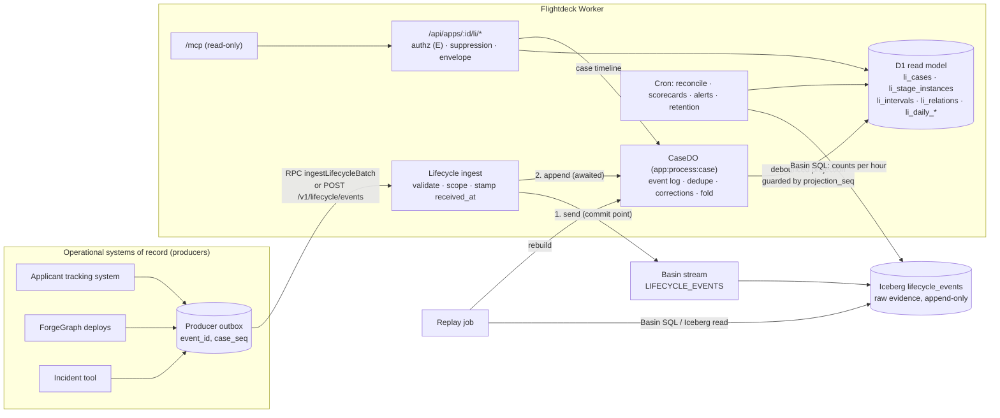

# 02 Architecture: three tiers, one direction of truth

## 2.1 The boundary



| Tier | Owner of | Mutable? | Lost if deleted? | Serves |
|---|---|---|---|---|
| **Operational system of record** (the producer) | The truth about a case: its current stage, its outcome, who works on it | Yes, by the business | Yes | Its own users. Flightdeck never writes back. |
| **Raw evidence**: Basin stream `LIFECYCLE_EVENTS` → Iceberg `flightdeck.lifecycle_events` on R2 | Every accepted event exactly as received, including duplicates and corrections, stamped with `received_at` and `channel` | Append-only. Removal only by retention or erasure rewrites (06) | **Yes. This is Flightdeck's store of record for lifecycles** | Replay, reconciliation, Explore, export (DuckDB, Spark) |
| **Read model**: CaseDO storage + D1 `li_*` tables | Derived state: ordered and deduped logs, stage instances, intervals, daily aggregates, diagnostics | Freely rewritten by projection and replay | **No.** Rebuilt from raw evidence | Dashboards, API, MCP, alerts |

### Rules that follow from the boundary

1. **Flightdeck never invents facts.** If the producer and Flightdeck disagree about a case, the
   producer is right. Flightdeck reports the disagreement as a diagnostic (`drift`, 07) and the
   producer fixes it by sending a correction or the missing events.
2. **Raw evidence is never rewritten to fix a mistake.** Mistakes are fixed by appending
   `event.corrected` events. Rewrites happen only for retention and erasure.
3. **The read model may be dropped at any time.** Every D1 `li_*` table and every CaseDO can be
   rebuilt from Iceberg by replay (07). A migration that needs new derived columns replays rather
   than backfilling by hand.
4. **Interactive reads never touch Basin SQL** (D13). Dashboards read D1 and, for one case at a
   time, the CaseDO.

## 2.2 Write path

1. **Authenticate and scope.** The app id comes from the service binding's `props.appId` or from a
   bearer key with the `lifecycle.write` scope, and the app must hold the `lifecycle.write`
   capability (A's migration). The payload never names the app.
2. **Validate the whole batch** against `LifecycleBatch` / `LifecycleEventV1` (structure) and the
   pinned definition (stage, dimension and relation allowlists). A batch is all-or-nothing: one
   invalid event rejects the batch with a permanent `lifecycle rejected: …` error, so producers can
   quarantine the event and never half-apply a transaction. (`main`'s analytics ingest does the
   opposite on purpose; lifecycle facts are business transitions, not page views.)
3. **Time checks.** Reject `occurredAt > received_at + 5 min`. Never clamp. Accept any past value
   down to `MIN_OCCURRED_AT` (2000-01-01).
4. **Commit to raw evidence**: `env.LIFECYCLE_EVENTS.send(rows)`. If it fails → 503, retryable.
5. **Append to CaseDOs**, grouped by `(processId, caseId)`, and **await** every append. If any
   append fails → 503, retryable. The retry re-sends to the stream (a duplicate row in Iceberg,
   removed by dedupe at read time) and to the CaseDO (a no-op for `eventId`s already logged).
6. **Return** `{ accepted, duplicates }`.

Why not reuse `main`'s best-effort fan-out? A dropped counter increment on `main` costs a slightly
wrong hourly count. A dropped `stage.exited` leaves a case stuck in a stage forever, inflating WIP
and dwell until someone notices. Awaiting the CaseDO turns that silent loss into a producer retry.
The cost is latency (target p95 < 250 ms for a 100-event batch touching ≤ 10 cases, see 12), which
server-side producers with an outbox tolerate.

## 2.3 CaseDO

One Durable Object per `(app_id, process_id, case_id)`, named
`li:${appId}:${processId}:${caseId}` (the same `idFromName` pattern as `sessionStub` in
`apps/flightdeck/src/do/shards.ts`). SQLite-backed, added with a new migration tag
(`v2`, `new_sqlite_classes: ["CaseDO"]`).

Storage:

```sql
-- Every distinct event ever accepted for this case, including corrections and retracted targets.
CREATE TABLE log (
  event_id TEXT PRIMARY KEY,
  payload_hash TEXT NOT NULL,        -- sha-256 of the canonical JSON; detects conflicting resends
  type TEXT NOT NULL,
  occurred_at INTEGER NOT NULL,
  source_sequence INTEGER NOT NULL,
  received_at INTEGER NOT NULL,
  body TEXT NOT NULL                 -- canonical JSON of the wire event
);
CREATE TABLE conflicts (event_id TEXT NOT NULL, payload_hash TEXT NOT NULL, received_at INTEGER NOT NULL);
CREATE TABLE meta (key TEXT PRIMARY KEY, value TEXT NOT NULL);
-- app_id, process_id, case_id, definition_version, projection_seq, projected_seq, dirty_since
```

Behavior:

- **append(rows)**: for each row, insert into `log` if `event_id` is new. If it exists with the
  same `payload_hash`, count a duplicate. If it exists with a different hash, keep the first, add a
  `conflicts` row and raise diagnostic `conflicting_duplicate`. If anything new was logged, bump
  `projection_seq`, set `dirty_since` if it is unset, and arm the projection alarm for
  `min(existing alarm, now + 2 s)`.
- **fold**: B's engine over the full log, sorted by `(occurred_at, source_sequence, event_id)`,
  with corrections applied first (04 §4.9). The fold is pure and deterministic: the same log always
  produces the same projection, whatever order the events arrived in.
- **alarm → project**: write the projection to D1 in one batch (§2.4), then set
  `projected_seq = projection_seq` and clear `dirty_since`. If D1 fails, retry with backoff
  (5 s, 30 s, 2 min, then every 10 min), and keep `dirty_since` so freshness reporting sees the lag.
- **timeline()**: the projected case for the case-detail API, read straight from the DO so a
  drill-down is never staler than the last accepted event.
- **Bounds**: at most 2,000 log rows per case (the `MAX_CASE_EVENTS` limit). The 2,001st event is
  rejected with permanent error `lifecycle rejected: case event limit`. A case that legitimately
  needs more should be split into child cases (05). At about 400 bytes per row this keeps a case
  under 1 MB.
- **Erasure**: `erase()` deletes all storage and returns the D1 tombstone write (06).

### Why one DO per case rather than per process

Corrections and out-of-order events need the full ordered history of one case and nothing else. A
per-case DO gives single-writer ordering without locks, and spreads a process across many DOs so no
shard gets hot. The existing `AppDO` hot-shard risk (R1 in the design doc) doesn't arise. Parent
rollups (05) are computed in D1, not by DOs calling each other.

## 2.4 D1 projection

Each projection replaces one case's rows in a single `db.batch`, which D1 runs as a transaction.
This is the same delete-and-insert technique as `writeHourlyRollup` in `apps/flightdeck/src/rollups.ts`,
with a guard so an older projection can't overwrite a newer one:

```sql
-- 1. Claim: only proceeds when this projection is newer than what D1 holds.
INSERT INTO li_cases (...) VALUES (...)
ON CONFLICT (app_id, process_id, case_id) DO UPDATE SET ...
WHERE excluded.projection_seq > li_cases.projection_seq;
-- 2..n. Replace child rows only if the claim won (subquery on projection_seq = ?).
DELETE FROM li_stage_instances WHERE app_id = ? AND process_id = ? AND case_id = ?
  AND (SELECT projection_seq FROM li_cases WHERE app_id = ? AND process_id = ? AND case_id = ?) = ?;
INSERT INTO li_stage_instances (...) SELECT ... WHERE (SELECT projection_seq ...) = ?;
```

Daily aggregates (`li_daily_stage`, `li_daily_case`) are **not** updated by CaseDOs; concurrent
increments from many DOs would race. They are recomputed per `(app, process, UTC day)` by the
aggregation step of the cron (07 §7.3) from `li_cases` and `li_stage_instances`, and only for days
touched since the last run. Those days are tracked in `li_dirty_days`, which each projection
upserts.

## 2.5 Failure modes

| Failure | What the producer sees | What happens | Recovery |
|---|---|---|---|
| Stream `send` fails | 503 `Retry-After: 5` | Nothing stored | Producer retries the same batch |
| Stream OK, a CaseDO append fails | 503 | Raw row stored, case not updated | Producer retries; the stream gets a duplicate row (deduped at read time); the CaseDO appends |
| Producer gives up after the stream accepted | Their outbox shows failed | Raw row exists, CaseDO missing it | Hourly reconciliation finds `raw > projected` for that hour and replays the case (07) |
| CaseDO OK, D1 projection fails | 200 | D1 stale for that case; `dirty_since` set | Alarm retries; freshness shows the lag; reconciliation flags it if the lag outlives an hour |
| D1 restored from an old Time Travel bookmark | n/a | Projections older than the DOs | `li replay --since <bookmark time>` re-projects from the DOs; `projection_seq` guards keep it safe |
| CaseDO storage lost or erased by mistake | n/a | Case missing from drill-down | Replay the case from Iceberg |
| Iceberg table corrupted or deleted | n/a | Raw evidence gone | Not recoverable from Flightdeck. R2 bucket versioning or replication is an operator choice (07 §7.7) |
| Definition version unknown at ingest | 4xx permanent | Batch rejected | Publish the definition first (`li definitions publish`), then resend |

## 2.6 What stays the same

The `EVENTS`/`SESSIONS` streams, `SessionDO`, `AppDO`, rollups, live and trends APIs, and the
browser SDK are untouched. Lifecycle code lives under `apps/flightdeck/src/lifecycle/` and is
reached only when `LIFECYCLE_MODE` is not `off` (12).
