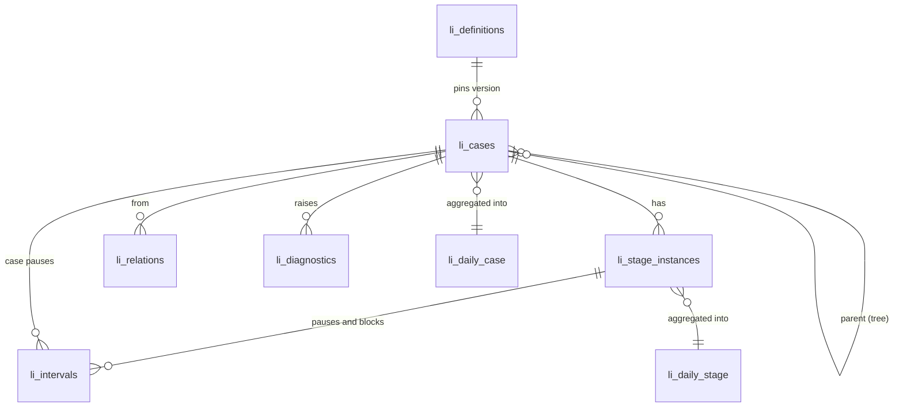

# 03 Event contract, idempotent ingest, graph and schemas

## 3.1 Which contract

The wire contract is workstream A's `LifecycleEventV1` (FLIG-19, unmerged). This section restates
it **as this RFC proposes it after normalization**. On 2026-10-31 A's draft and B's draft use
different transition names and correction shapes; they are **not compatible**, and nothing may be
released until [Gate G1](appendix-a-reconciliation.md#g1-shared-vocabulary) has fixed one
vocabulary and [Gate G2](appendix-a-reconciliation.md#g2-cross-branch-contract-test) proves both
sides agree on it.

The proposal keeps A's past-tense names because A owns the wire format and its schema is strict
(unknown fields fail closed). B's engine maps them through an adapter or renames its internal
union.

## 3.2 Event shape

```jsonc
{
  "schemaVersion": 1,
  "eventId": "dep-0007-a",            // 8–64 [A-Za-z0-9_-]; producer-minted, stable across retries
  "processId": "delivery.deploy",     // lowercase key
  "processVersion": 1,                // pinned definition version
  "caseId": "dpl_3c91e0",             // opaque, unique within (app, processId)
  "type": "stage.blocked",            // one of the transitions in 3.3
  "occurredAt": 1791547200000,        // epoch ms, when it happened in the source system
  "sourceSequence": 41,               // producer order within the case (outbox row id); breaks ties
  "source": "forgegraph",             // optional producing-system key
  "stageId": "approval",              // stage events only
  "stageInstanceId": "dpl_3c91e0.approval.1",
  "reason": "awaiting_approver",      // optional low-cardinality code; required for blocks (3.3)
  "relations": [{ "type": "parent", "objectType": "release", "objectId": "rel_2026_10_08" }],
  "dimensions": { "service_tier": "tier1", "env": "production" }
}
```

Field rules (A's draft, kept):

- `eventId` with the app is the idempotency key. Derive it deterministically from the source
  system's own record id (for example `sha256(source table + row id)`, truncated and base64url
  encoded). Never use a random id per send attempt.
- `caseId`, `stageInstanceId` and `objectId` are opaque: `^[A-Za-z0-9][A-Za-z0-9_.:-]{0,127}$`.
  No `@`, no spaces, so emails and names can't be pasted in by accident. 06 requires them to be
  **pseudonymous** too.
- `dimensions`: at most 16, keys checked against a sensitive-segment denylist (`name`, `email`,
  `salary`, …), and values short codes or booleans. Values must also appear in the definition's
  allowlist (`checkAgainstDefinition`).
- No free text anywhere: `reason`, `source`, keys and values are all codes.

## 3.3 Transitions

| Type | Scope | Required extra fields | Meaning |
|---|---|---|---|
| `case.created` | case | | The case exists: an application received, a deploy requested, an incident detected. Starts lead time. |
| `case.started` | case | | Work began. Optional; `startedAt − createdAt` is reported as queue time. |
| `case.paused` / `case.resumed` | case | `reason` recommended | Intentional clock stop for the whole case. |
| `case.completed` | case | `reason` optional | Closed with the outcome of the terminal stage it is in, or `success`. |
| `case.terminated` | case | `reason` recommended | Closed early: withdrawn, cancelled, rejected. Outcome comes from the terminal stage or `reason`. |
| `case.reopened` | case | `reason` optional | A closed case is open again. |
| `stage.entered` | stage instance | `stageId`, `stageInstanceId` | A visit to a stage began. |
| `stage.exited` | stage instance | `stageId`, `stageInstanceId` | The visit ended. `reason` can carry `failed`, `rework`, etc. |
| `stage.skipped` | stage instance | `stageId`, `stageInstanceId` | The stage was deliberately not performed. Zero-length instance, excluded from dwell, counted in funnels as skipped. |
| `stage.blocked` / `stage.unblocked` | stage instance | `stageId`, `stageInstanceId`, **`reason`** | An impediment started or ended. **The block is identified by `(stageInstanceId, reason)`.** |
| `stage.paused` / `stage.resumed` | stage instance | `stageId`, `stageInstanceId` | Clock stop for one stage instance. |
| `object.linked` / `object.unlinked` | case | `object` | A related object was attached or detached. |
| `event.corrected` | any | `correction: { targetEventId, action: "retract" \| "amend", occurredAt?, dimensions? }` | A fix to an earlier event (04 §4.9). |

Additions this RFC proposes (to be accepted or rejected under G1):

1. **`reason` is required on `stage.blocked`/`stage.unblocked`**, because it is half of the block
   identity. Today A has it optional. Without it, two overlapping blocks can't be paired with their
   unblocks.
2. **Reserved relation type `parent`**, at most one per case, carried on `case.created`. It makes the
   hierarchy explicit (05 §5.5) without a new top-level field.

## 3.4 Ingest surfaces

| Surface | Auth | Notes |
|---|---|---|
| `env.FLIGHTDECK.ingestLifecycleBatch({ events })` and `trackLifecycle(event)` | Service binding; `props.appId` must hold the `lifecycle.write` capability | For producers that are Workers or DOs in the same account. |
| `POST /v1/lifecycle/events` | `Authorization: Bearer <key>`; key must carry the `lifecycle.write` scope; app must hold the capability | Same limits as `POST /v1/server/events`: 256 KiB, `application/json`, no envelope fields other than `events`. Needs an Access bypass policy like `/v1/server/events` (`docs/operations/app-registration.md`). |

Limits: 100 events per batch (A's `MAX_LIFECYCLE_BATCH`), at most 10 distinct cases per batch
(proposed, to bound synchronous DO fan-out), 2,000 events per case lifetime (02 §2.3).

Responses:

| Status | Body | Producer action |
|---|---|---|
| 200 | `{ "accepted": 37, "duplicates": 3 }` | Mark the outbox rows sent. `duplicates` counts `eventId`s already logged. |
| 400 | `{ "error": "lifecycle rejected: <first problem>", "index": 12 }` | Permanent. Quarantine event `index`, fix the producer, resend the rest. |
| 401 / 403 | `{ "error": "Unauthorized" }` | Credential or capability problem. Stop and page the owner. |
| 409 | `{ "error": "lifecycle rejected: unknown definition delivery.deploy@3" }` | Publish the definition, then resend. |
| 413 / 415 | as on `main` | Fix the producer. |
| 503 | `{ "error": "Ingestion unavailable" }`, `Retry-After: 5` | Retry with bounded exponential backoff and **unchanged `eventId`s**. |

## 3.5 Idempotency end to end

| Layer | Key | Guarantee |
|---|---|---|
| Producer outbox | outbox row id → `eventId` | Each fact gets one id forever. |
| Basin stream → Iceberg | none | At least once. A retry after a 503 produces a duplicate row. |
| CaseDO `log` | `event_id` | Exactly once per case. Conflicting resends are kept out and reported. |
| D1 projection | `(app, process, case)` + `projection_seq` | Last-writer-wins by sequence; replays are no-ops when nothing changed. |
| Basin SQL readers (replay, reconciliation, Explore) | `(app_id, event_id)` | Must dedupe: `SELECT … FROM (SELECT *, row_number() OVER (PARTITION BY app_id, event_id ORDER BY received_at) rn …) WHERE rn = 1`, or a `GROUP BY` fallback if window functions are unsupported (G6). |

## 3.6 Raw evidence: the `lifecycle_events` stream

Owned by workstream A (`apps/flightdeck/pipelines/lifecycle_events.schema.json` on its branch).
The row type is A's `LifecycleRecord`:

| Column | Type | Notes |
|---|---|---|
| `event_id` | string, required | |
| `app_id` | string, required | From the credential, never the payload |
| `schema_version` | int32, required | |
| `process_id`, `process_version` | string, int32, required | |
| `type` | string, required | |
| `case_id` | string, required | |
| `stage_id`, `stage_instance_id` | string, optional | |
| `occurred_at`, `received_at` | timestamp (ms), required | |
| `source` | string, optional | |
| `source_sequence` | int64, required | |
| `reason` | string, optional | |
| `object_type`, `object_id` | string, optional | |
| `relations` | list of struct `{type, object_type, object_id}`, optional | A struct list, not JSON, so Basin SQL can filter it if supported |
| `dimensions` | json, optional | |
| `corrects_event_id` | string, optional | Lifted out of `correction` so readers can join without parsing JSON |
| `correction` | json, optional | |
| `channel` | string, required | `binding` or `http` |

Partitioning should be `(app_id, day(received_at))`, so reconciliation by receipt hour and replay
since a point in time prune well. Whether the Basin sink lets us choose partitioning is unverified
(G6). If it doesn't, replay filters on `received_at` and pays the scan cost (12 budgets).

## 3.7 Read model: the relational graph



### D1 DDL (proposed)

Migration numbers: the next free number when each owning PR merges (`li_definitions` in PR-05, the read model in PR-07, ops tables in PR-09). A's draft uses `0005`, E's PR #31 uses
`0010`; see G3. All tables are prefixed `li_` and have no foreign key to `apps`, for the same reason
as `hourly_rollups`: a late projection for a deleted app must not fail an alarm.

```sql
-- Published, immutable definitions (05). body is the canonical JSON of ProcessDefinitionV1 + additions.
CREATE TABLE li_definitions (
  app_id TEXT NOT NULL,
  process_id TEXT NOT NULL,
  version INTEGER NOT NULL,
  body TEXT NOT NULL,
  body_hash TEXT NOT NULL,
  sensitivity TEXT NOT NULL CHECK (sensitivity IN ('standard', 'restricted')),
  published_at INTEGER NOT NULL,
  published_by TEXT NOT NULL,          -- Access sub or service common_name
  PRIMARY KEY (app_id, process_id, version)
) WITHOUT ROWID;

CREATE TABLE li_cases (
  app_id TEXT NOT NULL,
  process_id TEXT NOT NULL,
  case_id TEXT NOT NULL,
  definition_version INTEGER NOT NULL,
  parent_process_id TEXT,
  parent_case_id TEXT,
  status TEXT NOT NULL CHECK (status IN ('open', 'closed', 'erased')),
  outcome TEXT,                        -- success | failure | neutral | null while open
  outcome_stage_id TEXT,
  current_stage_id TEXT,               -- open exclusive stage, null between stages or when closed
  current_stage_entered_at INTEGER,
  created_at INTEGER NOT NULL,
  started_at INTEGER,
  first_closed_at INTEGER,
  closed_at INTEGER,
  reopen_count INTEGER NOT NULL DEFAULT 0,
  -- Decomposition up to closed_at, or up to projected_at while open (04 §4.4).
  working_ms INTEGER NOT NULL, blocked_ms INTEGER NOT NULL, paused_ms INTEGER NOT NULL,
  between_ms INTEGER NOT NULL, closed_gap_ms INTEGER NOT NULL,
  dims TEXT,                           -- JSON of the latest allowlisted dimensions
  last_occurred_at INTEGER NOT NULL,
  last_received_at INTEGER NOT NULL,
  event_count INTEGER NOT NULL,
  diagnostic_count INTEGER NOT NULL,
  projection_seq INTEGER NOT NULL,
  projected_at INTEGER NOT NULL,
  PRIMARY KEY (app_id, process_id, case_id)
) WITHOUT ROWID;
CREATE INDEX li_cases_open ON li_cases (app_id, process_id, status, current_stage_id);
CREATE INDEX li_cases_created ON li_cases (app_id, process_id, created_at);
CREATE INDEX li_cases_closed ON li_cases (app_id, process_id, closed_at);
CREATE INDEX li_cases_parent ON li_cases (app_id, parent_process_id, parent_case_id);

CREATE TABLE li_stage_instances (
  app_id TEXT NOT NULL,
  process_id TEXT NOT NULL,
  case_id TEXT NOT NULL,
  stage_instance_id TEXT NOT NULL,
  stage_id TEXT NOT NULL,
  canonical_stage_id TEXT NOT NULL,
  visit INTEGER NOT NULL,              -- 1 for the first visit of stage_id in the case
  entered_at INTEGER NOT NULL,
  exited_at INTEGER,                   -- null while open (censored)
  skipped INTEGER NOT NULL DEFAULT 0,
  exit_reason TEXT,
  working_ms INTEGER NOT NULL, blocked_ms INTEGER NOT NULL, paused_ms INTEGER NOT NULL,
  PRIMARY KEY (app_id, process_id, case_id, stage_instance_id)
) WITHOUT ROWID;
CREATE INDEX li_si_stage ON li_stage_instances (app_id, process_id, stage_id, entered_at);
CREATE INDEX li_si_canonical ON li_stage_instances (app_id, process_id, canonical_stage_id, entered_at);

-- Pause and block intervals, already clipped to their instance (or case for case pauses).
CREATE TABLE li_intervals (
  app_id TEXT NOT NULL,
  process_id TEXT NOT NULL,
  case_id TEXT NOT NULL,
  stage_instance_id TEXT NOT NULL,     -- '' for case-level pauses
  kind TEXT NOT NULL CHECK (kind IN ('pause', 'block')),
  reason TEXT NOT NULL,                -- 'unspecified' when the producer sent none (pauses only)
  start_at INTEGER NOT NULL,
  end_at INTEGER,                      -- null while open
  attributed_ms INTEGER NOT NULL,      -- blocks: this reason's share after overlap split (04 §4.5)
  PRIMARY KEY (app_id, process_id, case_id, stage_instance_id, kind, reason, start_at)
) WITHOUT ROWID;

CREATE TABLE li_relations (
  app_id TEXT NOT NULL,
  process_id TEXT NOT NULL,
  case_id TEXT NOT NULL,
  type TEXT NOT NULL,
  object_type TEXT NOT NULL,
  object_id TEXT NOT NULL,
  linked_at INTEGER NOT NULL,
  unlinked_at INTEGER,
  PRIMARY KEY (app_id, process_id, case_id, type, object_type, object_id)
) WITHOUT ROWID;
CREATE INDEX li_relations_target ON li_relations (app_id, object_type, object_id);

CREATE TABLE li_diagnostics (
  app_id TEXT NOT NULL,
  process_id TEXT NOT NULL,
  case_id TEXT NOT NULL,
  code TEXT NOT NULL,                  -- 07 §7.5
  event_id TEXT NOT NULL DEFAULT '',
  detail TEXT,                         -- codes and ids only, never payload values
  first_seen_at INTEGER NOT NULL,
  PRIMARY KEY (app_id, process_id, case_id, code, event_id)
) WITHOUT ROWID;

CREATE TABLE li_dirty_days (
  app_id TEXT NOT NULL, process_id TEXT NOT NULL, day TEXT NOT NULL,  -- 2026-10-09
  marked_at INTEGER NOT NULL,
  PRIMARY KEY (app_id, process_id, day)
) WITHOUT ROWID;

-- Aggregates by UTC day of the stage instance's exit (closed) or of asOf (open). 08 explains use.
CREATE TABLE li_daily_stage (
  app_id TEXT NOT NULL, process_id TEXT NOT NULL, definition_version INTEGER NOT NULL,
  day TEXT NOT NULL, stage_id TEXT NOT NULL, canonical_stage_id TEXT NOT NULL,
  dims_key TEXT NOT NULL,              -- '' or a stable encoding of allowlisted dimension values
  entered INTEGER NOT NULL, exited INTEGER NOT NULL, skipped INTEGER NOT NULL, rework INTEGER NOT NULL,
  dwell_sum_ms INTEGER NOT NULL, working_sum_ms INTEGER NOT NULL,
  blocked_sum_ms INTEGER NOT NULL, paused_sum_ms INTEGER NOT NULL,
  dwell_hist TEXT NOT NULL,            -- JSON log-bucket histogram of closed dwell (08 §8.6)
  PRIMARY KEY (app_id, process_id, definition_version, day, stage_id, dims_key)
) WITHOUT ROWID;

CREATE TABLE li_daily_case (
  app_id TEXT NOT NULL, process_id TEXT NOT NULL, definition_version INTEGER NOT NULL,
  day TEXT NOT NULL, dims_key TEXT NOT NULL,
  created INTEGER NOT NULL, closed_success INTEGER NOT NULL, closed_failure INTEGER NOT NULL,
  closed_neutral INTEGER NOT NULL, reopened INTEGER NOT NULL,
  lead_sum_ms INTEGER NOT NULL, lead_hist TEXT NOT NULL,
  working_sum_ms INTEGER NOT NULL, blocked_sum_ms INTEGER NOT NULL, paused_sum_ms INTEGER NOT NULL,
  between_sum_ms INTEGER NOT NULL,
  PRIMARY KEY (app_id, process_id, definition_version, day, dims_key)
) WITHOUT ROWID;

CREATE TABLE li_reconcile_runs (
  app_id TEXT NOT NULL, hour TEXT NOT NULL,          -- received_at hour, 2026-10-09T14
  raw_distinct INTEGER NOT NULL, projected INTEGER NOT NULL,
  status TEXT NOT NULL CHECK (status IN ('ok', 'mismatch', 'replayed', 'error')),
  checked_at INTEGER NOT NULL,
  PRIMARY KEY (app_id, hour)
) WITHOUT ROWID;

CREATE TABLE li_erasures (
  app_id TEXT NOT NULL, process_id TEXT NOT NULL, case_id TEXT NOT NULL,
  requested_at INTEGER NOT NULL, requested_by TEXT NOT NULL,
  read_model_erased_at INTEGER, raw_rewritten_at INTEGER,
  PRIMARY KEY (app_id, process_id, case_id)
) WITHOUT ROWID;
```

Scorecard and alert tables are in 09. Grants are E's `authz_*` tables, not duplicated here.

### Why `li_intervals` stores `attributed_ms`

Per-reason blocked totals need the overlap split (04 §4.5), which needs every concurrent interval of
the instance. Computing it at query time would mean a self-join over intervals for every chart.
Computing it once in the fold and storing it keeps "blocked time by reason" a plain `SUM`.
