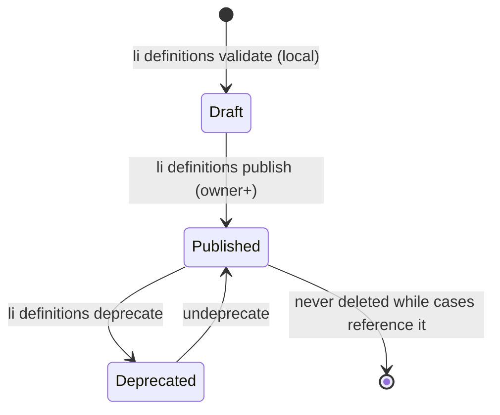

# 05 Process definitions, comparability, hierarchy and relations

## 5.1 What a definition is

A process definition says which stages, dimensions and relations a process may use, how its stages
group for display, and how they map to canonical stages for comparison. It is published once per
`(app_id, processId, version)` and **never edited** (D9). Changing anything, including a stage
label, means publishing a new version.

Workstream A's `ProcessDefinitionV1` (unmerged) already has `processId`, `version`, `name`,
`caseType`, `stages[{stageId, name, terminal?}]`, `dimensions[{key, values}]` and
`relations[{type, objectType}]`. Its schema is strict, so the additions below must land **in A's
PR before it merges** ([Gate G5](appendix-a-reconciliation.md#g5-definition-additions-before-the-schema-freezes)).
After A merges, each addition would need `schemaVersion: 2`.

### Proposed additions

| Field | Type | Default | Purpose |
|---|---|---|---|
| `sensitivity` | `"standard" \| "restricted"` | `"standard"` | `restricted` raises the suppression threshold, requires analyst grants for any case-level view, and forbids dimension breakdowns not marked `breakdown: true` (06). Hiring processes **must** be `restricted`. |
| `stages[].kind` | `"work" \| "wait" \| "terminal"` | `"work"` | `wait` stages (a queue, "awaiting offer response") count as working time in the decomposition but are colored as waiting in the UI and excluded from flow-efficiency numerators when `flowEfficiency.excludeWaitStages` is true. `terminal` replaces A's `terminal: true`. |
| `stages[].outcome` | `"success" \| "failure" \| "neutral"` | required when `kind = "terminal"` | Case outcome when it closes in this stage. |
| `stages[].group` | key | stage's own id | Outer segment of the nested bar (11), such as `interview_loop`. |
| `stages[].canonicalStageId` | key | `stageId` | Version-independent stage for comparisons (§5.3). |
| `stages[].order` | integer | array index | Display and funnel order. |
| `stages[].ageLimitMs` | integer | none | Default stage age limit used by alerts (09). |
| `dimensions[].breakdown` | boolean | `false` | Whether queries may group by this dimension. Filters are always allowed. |
| `failureReasons` | key[] | `["failed"]` | `stage.exited` reasons that count as a failed attempt for first-pass yield. |
| `predecessor` | `{ version, stageMap: { [oldStageId]: newStageId[] } }` | none | How the previous version's stages correspond to this one's (§5.3). |
| `calendar` | key | `"wall"` | Reserved; only `"wall"` is valid in v1 (04 §4.13). |
| `maxDepth` | integer 1–4 | 4 | Hierarchy depth limit for cases of this process (§5.5). |
| `retention` | `{ closedDays?, rawDays? }` | 06 §6.5 defaults | Shorter retention for this process; never longer without an admin override. |
| `readModel` | `{ aggregatesOnlyAfter?: duration }` | none | Drops instance and interval rows for cases closed longer ago than this, keeping `li_cases` and daily aggregates (12 §12.3). |
| `relations[].processId` | key | none | On `parent` entries: the parent's process, so a `parent` link resolves to a case (§5.5). |

Example: [`examples/hiring/definitions/hiring.application.v2.json`](examples/hiring/definitions/hiring.application.v2.json).

## 5.2 Lifecycle of a definition



- **Publish** (`POST /api/apps/:app/li/definitions`, `owner` or `admin`): validates the body,
  computes `body_hash`, and inserts into `li_definitions`. Republishing the identical body is
  idempotent (200). A different body under an existing version is 409.
- **Deprecated** versions still accept events for open cases pinned to them, but ingest raises
  `deprecated_definition` on `case.created` under a deprecated version.
- **Pinning.** A case is pinned to the `processVersion` of its first effective event. Later events
  with a different version are rejected at the CaseDO with diagnostic `version_mismatch`, unless
  they are part of a migration (§5.4).
- **Validation at publish**: stage ids are unique; terminal stages have an outcome; every
  `canonicalStageId` used by `predecessor.stageMap` targets exists; `group`s are contiguous in
  `order`; dimension keys pass A's sensitive-key check and, for `restricted` processes, the
  protected-characteristic denylist (06 §6.3).

## 5.3 Comparability across versions

Comparisons across versions go through canonical stages. For each canonical stage and each pair of
versions, the publish step derives a **comparability class** from the mapping:

| Mapping (old → new) | Class | Allowed comparisons |
|---|---|---|
| 1 → 1, same canonical id | `exact` | Stage-level dwell, conversion and funnels across versions |
| n → 1 (stages merged) | `merged` | At the canonical level. The old stages' visits are concatenated into canonical visits (§5.3.1). |
| 1 → n (stage split) | `merged` at the canonical level if all new stages share one canonical id, otherwise `not_comparable` | Canonical-level only. Fine-grained new stages have no old counterpart. |
| Stage added or removed with no mapping | `not_comparable` | Reported per version, never pooled |

The API puts `comparability` in every response that spans versions (08). When any requested series
is `not_comparable`, the response splits it by version instead of pooling, and adds a warning.

### 5.3.1 Canonical visits

Consecutive stage instances of one case that map to the same canonical stage form one **canonical
visit**: entered at the first instance's entry, exited at the last instance's exit. Their working,
blocked and paused times add up. Example: hiring v2 splits v1's `onsite` into
`technical_interview` and `team_interview`, both with `canonicalStageId: "interview"`. A v2 case
going `screen → technical_interview → team_interview → offer` has one canonical `interview` visit
spanning both, so it compares with a v1 `onsite` visit.

### 5.3.2 Rules of thumb for definition authors

- Keep `canonicalStageId` stable for the life of the process. Rename labels freely.
- Split a stage by giving the new stages the old stage's canonical id.
- Prefer adding a `wait` stage to overloading `stage.blocked` for routine queues.

## 5.4 Migrating open cases to a new version

Cases stay on their pinned version by default, and old and new versions coexist. To move open cases,
the producer sends `case.migrated` (a proposed transition, decided under G1) with
`{ fromVersion, toVersion, stageInstanceMap }` at a chosen `occurredAt`. The CaseDO closes the
mapped instances and opens their counterparts at that instant, without diagnostics. If G1 rejects
the new transition, the fallback is: no migration, cases finish on their pinned version.

## 5.5 Hierarchy (tree) (D10)

A case may have one **parent**, declared with the reserved relation type `parent` on
`case.created`:

```json
{ "type": "case.created", "caseId": "appl_7d21c9",
  "relations": [{ "type": "parent", "objectType": "requisition", "objectId": "req_4b8e10" }] }
```

`objectType` is the parent's `caseType`, and `objectId` its `caseId`. The parent's `processId` is
resolved through the definition's `relations` allowlist entry `{type: "parent", objectType,
processId}`, an addition proposed under G5.

Rules:

- **Acyclic, depth ≤ 4** (`maxDepth`). The D1 projection checks the parent chain on write; a cycle
  or overflow raises `parent_cycle` / `parent_depth` and the link is dropped from rollups but kept in
  the log.
- **The parent may arrive later than its children.** A child that names an unknown parent is stored
  with `parent_case_id` set; rollups pick it up when the parent appears.
- **Re-parenting** uses `object.unlinked` + `object.linked` with type `parent`, effective at their
  `occurredAt`.
- **Rollups flow up only through the tree**: a parent's view shows its children's counts by stage,
  outcome and WIP age (computed in D1 by `li_cases_parent` index lookups), and the "time in children"
  overlay (11).
- **The parent's time is its own.** Children don't change the parent's decomposition. A parent
  waiting on children should model that as a `wait` stage or a block with reason `awaiting_children`.

Hiring example: `headcount_plan → requisition → application → interview_loop → assessment` (C's
demo hierarchy). Deployment: `release → deploy → regional_rollout`. Incident:
`incident → remediation`.

## 5.6 Parallel work

Work that happens in parallel within one case (a take-home assessment running while interviews are
scheduled, regional rollouts running at once, several remediation tasks) is modelled as **child
cases**, each with its own exclusive stage track. This keeps the one-open-stage rule (04 §4.2),
gives every parallel strand its own dwell and censoring, and puts parallelism in the tree where the
UI can show it.

## 5.7 Cross relations (graph)

Every other relation type is a typed, directed edge from a case to an object, which is often, but
not necessarily, another case:

| Type | Example | Notes |
|---|---|---|
| `caused_by` | incident → deploy | Drives the "incidents caused by deploys" metric (09) |
| `blocked_by` | deploy → change request | A block's `reason` can be paired with a `blocked_by` relation to name the blocker |
| `duplicates` | incident → incident | Duplicates are excluded from incident counts when `excludeDuplicates` is set |
| `related` | anything | Navigation only |
| `affects` | incident → service | Object type `service`, which is not a case |

Rules:

- Many-to-many, cycles allowed, **no rollups or time propagation** along graph edges.
- Edges stay inside one app. Cross-app links use `objectType`/`objectId` as opaque references; the
  API resolves them only if the caller is granted on both apps (06).
- Both directions are queryable: `li_relations` has the forward key and the `li_relations_target`
  index for reverse lookups ("which incidents name this deploy?").
- Allowed `(type, objectType)` pairs come from the definition (A's `relations` list), so producers
  can't invent edge types at runtime.
