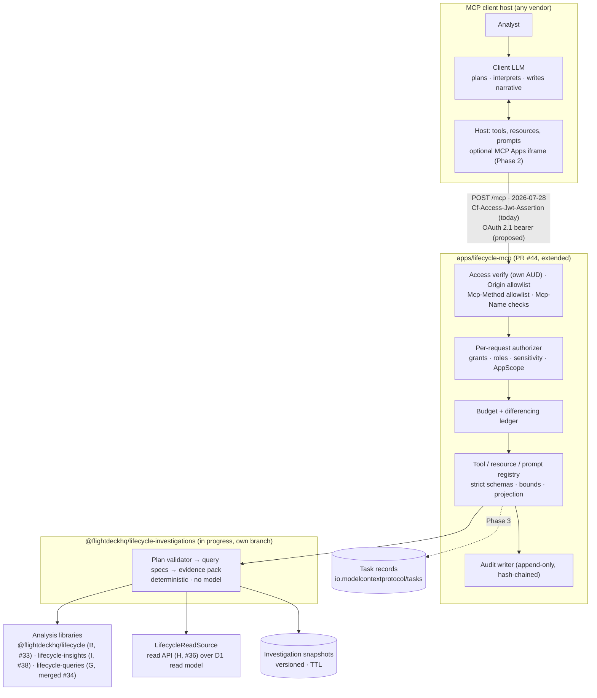

# 14 AI-assisted lifecycle analysis over MCP

| | |
|---|---|
| Status | **Proposed. Nothing in this document is implemented** except where a row says "Implemented (draft PR, unmerged)". |
| Issue | [FLIG-17](https://tasks.gmac.io/gmacko/issue/FLIG-17) (this RFC). Builds on [FLIG-23](https://tasks.gmac.io/gmacko/issue/FLIG-23) / draft PR #44. |
| Date | 2026-10-31 |
| Extends | [10 §10.5](10-instrumentation-cli-sdk-mcp.md#105-read-only-mcp-for-agents-d14) (read-only MCP) and D14. Where the two differ, this document describes the target and 10 §10.5 describes the v1 baseline. |
| Companion | `packages/lifecycle-investigations` (`@flightdeckhq/lifecycle-investigations`), in progress on branch `feat/lifecycle-ai-investigations`. On 2026-10-31 that worktree has no commits or files yet. **No code is edited here.** |

## 14.0 Sources checked

Every protocol claim below was checked against one of these sources on 2026-10-31. Anything not
covered by them is marked **unverified**.

| Claim | Source |
|---|---|
| The existing server: `apps/lifecycle-mcp`, protocol **2026-07-28**, `@modelcontextprotocol/server` 2.4.0, stateless `createMcpHandler`, `POST /mcp` only, `legacy: "reject"`, `tools` + `resources` only, method allowlist, Access JWT with the MCP host's own AUD, Origin allowlist, grants mirroring FLIG-18, k ≥ 5 with complementary suppression, bounds, `provenance` + `interpretation.causal: false`, production refused | Draft PR #44, `docs/operations/lifecycle-mcp.md` on `feat/lifecycle-mcp-readonly` |
| 2026-07-28 deprecates logging (`logging/setLevel`, `notifications/message`) and sampling (`sampling/createMessage`, model preferences, tool use in sampling): "SEP-2577; remains in the specification for at least twelve months" | `@modelcontextprotocol/core` 2.4.0 dist, JSDoc `@deprecated` tags |
| 2026-07-28 removes core Tasks ("the era that removed them from core"); the 2025-11-25 task vocabulary "has no SDK runtime" | same |
| SEP-2322: `elicitation/create`, `sampling/createMessage` and `roots/list` are no longer wire requests; they are embedded in `input_required` results | same |
| SEP-2549 `CacheableResult` requires `ttlMs` and `cacheScope` (`public` \| `private`) on cacheable results | same |
| `subscriptions/listen` replaces the GET stream and `resources/subscribe`; `server/discover` | same |
| SEP-2663 Tasks extension: id **`io.modelcontextprotocol/tasks`**; methods `tasks/get`, `tasks/update`, `tasks/cancel`; **no `tasks/list`**; `resultType: "task"`; statuses `working`, `input_required`, `completed`, `cancelled`, `failed`; `ttlMs`, `pollIntervalMs`; client opts in through per-request capabilities and the server decides per request; servers **MUST** authenticate and authorize every task request; `Mcp-Name` header = `params.taskId` on Streamable HTTP | [SEP-2663](https://modelcontextprotocol.io/seps/2663-tasks-extension) (Final); SDK 2.4.0 `MCP_NAME_HEADER_SOURCE` |
| SDK 2.4.0 ships **no** Tasks-extension runtime and **no** MCP Apps support (its only extension module is Skills, SEP-2640) | SDK dist inspection |
| MCP Apps (SEP-1865): extension id `io.modelcontextprotocol/ui`, `ui://` resources with mimeType `text/html;profile=mcp-app`, tool `_meta.ui.resourceUri`, `_meta.ui.visibility` (`"model"`, `"app"`; default both), sandboxed iframe, JSON-RPC over `postMessage`, `_meta.ui.csp` | [ext-apps spec 2026-01-26](https://github.com/modelcontextprotocol/ext-apps/blob/main/specification/2026-01-26/apps.mdx) |
| Cloudflare OS Gadgets: per-user app instances in a Dynamic Worker facet backed by a Durable Object, client in a sandboxed iframe talking Cap'n Web RPC over `postMessage`; Gatekeepers mediate external access; the README doesn't mention MCP Apps | [cloudflare/cloudflare-os README](https://github.com/cloudflare/cloudflare-os) |

## 14.1 Goal, and what "AI-assisted" means here

Let an analyst ask a capable AI client, in plain language, "why did interview-loop dwell rise this
quarter?", and get an answer that is **grounded in deterministic, cited, privacy-safe evidence**.

The division of labour is the core of the design:

| Layer | Does | Must not |
|---|---|---|
| **Client LLM** (the user's own model, any vendor) | Turn a question into a plan; choose tools; read evidence; write the narrative; ask follow-ups; seek counterevidence | Compute statistics itself from raw rows (it never gets raw rows); claim causation; make decisions about people |
| **Flightdeck MCP server** | Authenticate, authorize every request, validate, bound, budget, audit, route | Run a model (none by default); accept SQL or free-text queries |
| **Investigation engine** (`@flightdeckhq/lifecycle-investigations`) | Deterministically turn a typed plan into query specs, run them, apply 04's semantics, compute effects and diagnostics, assemble an **evidence pack** | Interpret beyond what the numbers support; call an LLM |
| **Read API and read model** (#36, D1) | Serve derived aggregates and single-case snapshots under grants | Serve raw Basin events to MCP |

**No server-side model by default.** The server has no model, no API keys, and no
`sampling/createMessage` (deprecated in 2026-07-28 anyway). Narratives come from the client's
model, so the design is model-agnostic: any MCP 2026-07-28 client works. An operator could later
add an optional server-side summarizer for proactive digests (Phase 3), but it would be off by
default, and it would consume the same evidence packs and pass the same release gates.

## 14.2 Guardrails (normative)

1. **No raw candidate, resume, application, interview-feedback, scorecard or note content**, ever.
   It isn't in the contract (03, 06), so no tool can return it. The output projection drops any
   field not declared in the output schema (#44's `privacy.ts` pattern).
2. **No hiring-decision automation.** No tool ranks, scores, recommends, advances or rejects an
   individual. Output schemas have no per-person recommendation fields. Prompts instruct the client
   that outputs are process-level and descriptive. A request like "which candidates should we
   reject" gets `refused: "decision_automation"`.
3. **No case-level data for `restricted` processes over MCP.** Aggregates only, with k = 10. Case
   tools (`get_case_summary`, `get_case_timeline` in #44) return `forbidden` for restricted
   processes whatever the caller's role.
4. **No personal data**: opaque ids only, and no actor identities (06 §6.2).
5. **No arbitrary SQL, expressions, free-text search, or cross-app joins.** Every input is an
   allowlisted code. Each investigation is scoped to exactly one app. Cross-app relations appear
   only as opaque references, without resolution (05 §5.7).
6. **Suppression and differencing rules apply to every number**, including those inside evidence
   packs and MCP App views (§14.6).
7. **Every quantitative statement carries its context**: event-time window, knowledge time and
   watermark, `n`, `n_censored`, coverage, process versions and comparability, and case-mix
   matching. Every interpretation is explicitly non-causal (§14.5).
8. **Read-only.** Every tool is annotated `readOnlyHint: true`, `destructiveHint: false`,
   `openWorldHint: false`. Snapshots are server-side cache records, not user-visible writes.
   Creating one is idempotent by content hash, so the tools are `idempotentHint: true`.
9. **Hierarchies never sum child time into parent time**, and never expose leaf records of
   restricted processes. Sensitivity is inherited down the tree (§14.7.1).

## 14.3 Architecture



### Layers

| # | Layer | State on 2026-10-31 |
|---|---|---|
| L0 | Client host and LLM | External. Tested in #44 only with the SDK client in process. |
| L1 | Transport and identity: Streamable HTTP `POST /mcp`, Access JWT with the MCP host's own AUD, Origin allowlist | **Implemented (draft PR #44, unmerged)** |
| L1b | OAuth 2.1 protected-resource metadata, for generic clients | **Not implemented** (#44 says so). Proposed in §14.4 |
| L2 | Per-request authorization, method allowlist, strict schemas, bounds, projection, k-suppression | **Implemented (draft PR #44)** for its 9 tools; extended here |
| L2b | Query budget, differencing ledger, immutable audit | **Not implemented** (#44: "No rate limiting or per-caller query budget") |
| L3 | Investigation engine | **Not implemented** (companion branch has no code yet) |
| L4 | Analysis libraries | B #33 draft; I #38 draft (controlled comparisons with matched strata, standardization, Simpson warnings); G merged #34 |
| L5 | Read API and read model | H #36 draft, not wired; #44's `read-api` source fails closed |
| L6 | Snapshots, task records | **Not implemented** |
| L5b | Related-case data: parent/child rollups, case relations | **Not implemented.** #44's `LifecycleReadSource` has no related-case method; H #36 stores case edges and parent links but exposes no route for them. A **future data-source capability** (§14.7.1) |

### Request path (every request, no exceptions)

1. Verify the Access JWT (or, later, the OAuth bearer token). Fail → 401 before any MCP parsing.
2. Check the `Mcp-Method` allowlist and the `Mcp-Name` mirror. Methods outside the phase's set →
   `-32601`.
3. **Re-load grants** for `(principal, app)`, with no cache (FLIG-18 behavior). Mint an `AppScope`
   or refuse with the uniform `forbidden`.
4. Resolve process sensitivity. Restricted processes get the restricted rule set.
5. Validate arguments strictly. Unknown keys (`sql`, `query`, `expression`) → `invalid_argument`.
6. **Charge the budget** with the tool's cost class. Check the differencing ledger.
7. Execute through the investigation engine and the read source.
8. Project to the output schema; suppress; attach `meta` (§14.5).
9. Append an audit record **after the response is decided and before it is sent**. If the audit
   write fails, the response fails (`internal`).

## 14.4 Identity, OAuth and scoping

| Principal | How it authenticates | Ceiling |
|---|---|---|
| Person through a client that can send Access JWTs (or via `cloudflared access`) | `Cf-Access-Jwt-Assertion` for the MCP Access application (implemented in #44) | Their FLIG-18 grant per app |
| Person through a generic MCP client | **Proposed:** OAuth 2.1 bearer token. The server publishes protected-resource metadata (RFC 9728) at `/.well-known/oauth-protected-resource` naming Cloudflare Access as the authorization server, with resource indicator `https://<mcp-host>/mcp` and audience checks. Whether Access can act as the authorization server for this flow in the target account is **unverified** (gate AI-G3). | Same grants; scopes `lifecycle:read`, `process:read` (#44 names) map to roles; a token never widens a grant |
| Service token (agents in CI, scheduled jobs) | Access service token (`common_name`) | **reader only, one app** (FLIG-18 SQL constraint). Gets no aggregates in #44, and nothing on restricted processes here |

Role → tool matrix:

| Tool group | reader | analyst | owner/admin | Restricted process |
|---|---|---|---|---|
| Definitions, glossary, `describe_metric`, `get_data_freshness` | ✓ | ✓ | ✓ | ✓ |
| #44 case tools | ✓ | ✓ | ✓ | **✗ (all roles)** |
| Aggregates: #44 aggregate tools, `get_process_health`, `diagnose_bottlenecks`, `get_data_quality` | ✗ | ✓ | ✓ | analyst+, k = 10 |
| Investigations: `plan_investigation`, `collect_evidence`, `explain_dwell_change`, `compare_variants`, `evaluate_intervention`, `list_evidence_references` | ✗ | ✓ | ✓ | analyst+, k = 10, restricted query rules (06 §6.4) |
| Async tasks (Phase 3) | ✗ | ✓ | ✓ | analyst+ |
| Hierarchy (future): `aggregate_child_rollup` | ✗ | ✓ | ✓ | analyst+, k = 10, inherited sensitivity |
| Hierarchy (future): `get_case_relations` | ✗ | ✓ (person) | ✓ (person) | **✗ (all roles)** |

## 14.5 Evidence model

### Evidence item

Every number an investigation produces is an **evidence item** with a stable id, so the client
LLM's narrative can cite it and a reviewer can resolve the citation.

```jsonc
{
  "evidence_id": "ev_7Q2M",                       // unique within the pack
  "kind": "stage_dwell",                          // stage_dwell | lead_time | conversion | blocked_share | wip | throughput | data_quality | comparison | intervention | bottleneck_signal
  "claim_code": "dwell.p50.increased",            // machine code; prose is written by the client
  "subject": { "process_id": "hiring.application", "canonical_stage_id": "interview" },
  "value": { "stat": "km_median_ms", "current": 820800000, "baseline": 676800000, "delta": 144000000 },
  "interval": { "method": "bootstrap_percentile", "level": 0.95, "low": 36000000, "high": 241200000 },
  "sample": { "n": 142, "n_closed": 118, "n_censored": 24, "n_excluded": 2, "excluded": { "invalid_interval": 2 } },
  "coverage": { "cases_in_scope": 146, "cases_measured": 142, "ratio": 0.973, "watermark_complete": true },
  "time": {
    "event_window": { "from": "2026-07-01", "to": "2026-10-01", "field": "occurredAt", "cohort": "closed_or_censored_in_window" },
    "baseline_window": { "from": "2026-04-01", "to": "2026-07-01" },
    "knowledge_as_of": "2026-10-31T09:00:00Z",    // what the read model knew: received_at cutoff
    "watermark": "2026-10-31T08:58:41Z",          // projected_through for this process (08 §8.3)
    "verified_through": "2026-10-30T22",          // last reconciled receipt hour
    "as_of": "2026-10-31T09:00:00Z"               // "now" for open cases (censoring)
  },
  "versions": { "definition_versions": [1, 2], "comparability": "merged", "fold_version": 3, "engine_version": "0.1.0" },
  "case_mix": { "matched_on": ["level", "channel"], "standardization": "pooled_weights", "matched_coverage": 0.91, "unmatched_strata": 1 },
  "privacy": { "k": 10, "suppressed_cells": 1, "rounded": true },
  "interpretation": { "causal": false, "evidence": "observed_association",
                      "caveats": ["right_censoring_present", "version_change_in_window", "case_mix_shift"] },
  "query_fingerprint": "qf_sha256:3b9c…"          // normalized query hash; no argument values in clear
}
```

### Evidence pack

```jsonc
{
  "investigation_id": "inv_01JC…",       // ULID
  "snapshot_version": 1,                  // bump on any recompute
  "pack_hash": "sha256:…",                // over canonical JSON of items + manifest
  "app_id": "app_hiring", "process_id": "hiring.application",
  "question_code": "dwell_change",        // from plan_investigation
  "items": [ /* evidence items */ ],
  "counterevidence": [ "ev_9KD1" ],       // items that cut against the leading explanation
  "data_quality": [ "ev_DQ01" ],
  "limitations": ["not_causal", "censoring_24_of_142", "v2_split_interview_stage"],
  "created_at": "…", "expires_at": "…",   // TTL (§14.9)
  "principal_binding": "pb_sha256:…"      // hash of (principal kind, subject, app); not the subject in clear
}
```

**Citations.** The client cites as `[ev:inv_01JC…/ev_7Q2M]`. `list_evidence_references` and the
resource `lifecycle://investigations/{investigation_id}/evidence/{evidence_id}` resolve citations,
re-authorizing on every read.

### Time semantics in evidence

- **Event time** (`occurredAt`) defines windows and durations (04 §4.1).
- **Knowledge time** (`knowledge_as_of`) is the receipt cutoff of what the read model had
  projected. A snapshot pins it, together with the read model's source generation (#36's
  generation numbers), so re-reading a snapshot reproduces the same numbers even after late events
  arrive. A fresh `collect_evidence` call may differ, and the response says why
  (`knowledge_advanced: true`).
- **Watermark incomplete** (`watermark_complete: false`) means the window includes receipt hours
  not yet projected or reconciled. Evidence items say so, and comparison tools refuse to rank
  windows with incomplete watermarks (I #38's fail-closed rule).
- **Right-censoring.** Durations report the Kaplan–Meier median next to closed-only percentiles
  (04 §4.7). `n_censored` is always present.

### Non-causal contract

Every item and pack carries `interpretation.causal: false`. Allowed claim codes are descriptive
(`increased`, `decreased`, `no_clear_change`, `concentrated_in_stage`, `associated_with_dimension`,
`coincides_with_version_change`). There is no claim code for "caused", "due to" or "because". The
prompts (§14.8) tell the client to use associative language and to name the counterevidence.

## 14.6 Privacy for aggregates vs cases

| Concern | Rule |
|---|---|
| Small cohorts | k = 5 (standard) or 10 (restricted) distinct cases per cell. Complementary suppression. Rare paths pooled into `other` (#44). |
| Differencing | Per principal and app, the ledger stores `(query_fingerprint, window, filters, breakdown)` for 30 days. On restricted processes a new query is refused (`differencing_risk`) when it overlaps a previous one so that their difference isolates fewer than k cases: same breakdown and filters with windows differing by less than 28 days, or the same window with filter sets differing in one dimension value whose complement is < k. Windows must align to UTC weeks. |
| Repeated small queries | The budget caps distinct fingerprints per day (§14.9). |
| Case-level | Never for restricted processes. For standard processes, `analyst` person grants only; opaque ids; no dimensions on restricted. Case tools are excluded from investigations' evidence packs (packs are aggregate-only). |
| Evidence packs and snapshots | Stored already suppressed. Reading one re-applies the **current** k and grants: a pack created under k = 5 is re-suppressed if k rose to 10 (§14.9). |
| MCP App views | Receive only the tool's suppressed structured output; app-only pagination and filters call tools with the same suppression and budget (§14.10). |

## 14.7 Tools (v1 target)

The nine tools in #44 stay as they are (`list_workflow_definitions`, `get_case_summary`,
`get_case_timeline`, `get_stage_dwell`, `get_funnel`, `compare_workflow_variants`,
`list_bottlenecks`, `describe_metric`, `get_data_freshness`), except that case tools are refused on
restricted processes. The tools below are new. All are `readOnlyHint: true`, `idempotentHint: true`,
`destructiveHint: false`, `openWorldHint: false`, and return both `structuredContent` (matching
`outputSchema`) and a short text summary for clients that don't use structured output.

### Shared definitions

```jsonc
{
  "$defs": {
    "Key": { "type": "string", "pattern": "^[a-z][a-z0-9_.-]{0,63}$" },
    "Scope": { "type": "object", "additionalProperties": false,
      "required": ["app_id", "process_id"],
      "properties": { "app_id": { "type": "string", "pattern": "^[\\w-]{3,64}$" },
                      "process_id": { "$ref": "#/$defs/Key" },
                      "versions": { "oneOf": [{ "const": "all" }, { "type": "array", "items": { "type": "integer", "minimum": 1 }, "maxItems": 8 }] } } },
    "Window": { "type": "object", "additionalProperties": false, "required": ["from", "to"],
      "properties": { "from": { "type": "string", "format": "date" }, "to": { "type": "string", "format": "date" },
                      "cohort": { "enum": ["opened", "closed", "active"] } } },
    "Filters": { "type": "object", "maxProperties": 3,
      "additionalProperties": { "type": "string", "pattern": "^[A-Za-z0-9][A-Za-z0-9_.:-]{0,63}$" } },
    "EvidenceRef": { "type": "object", "additionalProperties": false, "required": ["investigation_id", "evidence_id"],
      "properties": { "investigation_id": { "type": "string", "pattern": "^inv_[0-9A-HJKMNP-TV-Z]{26}$" },
                      "evidence_id": { "type": "string", "pattern": "^ev_[A-Z0-9]{4,12}$" } } },
    "Meta": { "description": "08 §8.3 envelope meta plus investigation fields", "type": "object",
      "required": ["as_of", "knowledge_as_of", "watermark", "sample", "comparability", "suppression", "interpretation", "cost"],
      "properties": { "cost": { "type": "object", "properties": { "units": { "type": "integer" }, "remaining_today": { "type": "integer" } } } } }
  }
}
```

Errors (fixed codes, as in #44): `forbidden`, `not_found`, `invalid_argument`, `refused`
(`decision_automation`, `restricted_case_level`, `personal_data`), `differencing_risk`,
`budget_exhausted` (with `retry_after`), `watermark_incomplete`, `insufficient_data`,
`source_unavailable`, `result_too_large`, `internal`.

### `plan_investigation`

Turns a question **code** (not free text) and a scope into a typed, validated plan. It runs no
data queries. The client LLM maps the user's prose onto a question code; the server never parses
prose.

```jsonc
// inputSchema
{ "type": "object", "additionalProperties": false, "required": ["scope", "question"],
  "properties": {
    "scope": { "$ref": "#/$defs/Scope" },
    "question": { "enum": ["process_health", "dwell_change", "bottlenecks", "variant_comparison", "intervention_effect", "data_quality"] },
    "window": { "$ref": "#/$defs/Window" },
    "baseline_window": { "$ref": "#/$defs/Window" },
    "focus_stage": { "$ref": "#/$defs/Key" },
    "dimensions": { "type": "array", "items": { "$ref": "#/$defs/Key" }, "maxItems": 2 } } }
// outputSchema (key fields)
{ "plan_id": "pln_…", "steps": [{ "step": 1, "tool": "get_data_quality", "args": { } }, { "step": 2, "tool": "explain_dwell_change", "args": { } }],
  "estimated_cost_units": 14, "restrictions_applied": ["restricted_k10", "week_aligned_windows"],
  "warnings": ["baseline_overlaps_version_change"], "meta": { } }
```

Cost class: 1 unit. The plan is advisory: the client may run the steps, or call
`collect_evidence` with the `plan_id` to run them in one call.

### `collect_evidence`

Executes a plan, or an explicit list of evidence requests, and returns an **evidence pack**, stored
as a versioned snapshot.

```jsonc
// inputSchema
{ "type": "object", "additionalProperties": false, "required": ["scope"],
  "oneOf": [{ "required": ["plan_id"] }, { "required": ["requests"] }],
  "properties": {
    "scope": { "$ref": "#/$defs/Scope" },
    "plan_id": { "type": "string", "pattern": "^pln_[A-Za-z0-9]{8,32}$" },
    "requests": { "type": "array", "maxItems": 12, "items": { "type": "object", "additionalProperties": false,
      "required": ["kind"], "properties": {
        "kind": { "enum": ["stage_dwell", "lead_time", "conversion", "blocked_share", "wip", "throughput", "data_quality"] },
        "window": { "$ref": "#/$defs/Window" }, "baseline_window": { "$ref": "#/$defs/Window" },
        "stage": { "$ref": "#/$defs/Key" }, "filters": { "$ref": "#/$defs/Filters" },
        "breakdown": { "$ref": "#/$defs/Key" } } } },
    "include_counterevidence": { "type": "boolean", "default": true } } }
// outputSchema: EvidencePack (§14.5) + meta
```

Cost class: sum of the request costs (2–8 units each). Above 40 units, or when the estimated D1
rows exceed the 12 §12.4 budget, the call is refused with `invalid_argument: too_expensive_sync` in
Phases 1–2. In Phase 3 the server may create a task instead (§14.11).

### `get_process_health`

A one-call overview: lead time (closed-only p50/p90 and the KM median), throughput, WIP and WIP
age, blocked share, rework, reopen rate and age-limit breaches. Each value is an evidence item,
compared with a baseline window.

```jsonc
// inputSchema
{ "type": "object", "additionalProperties": false, "required": ["scope"],
  "properties": { "scope": { "$ref": "#/$defs/Scope" }, "window": { "$ref": "#/$defs/Window" },
                  "baseline": { "enum": ["previous_window", "same_window_last_year", "none"], "default": "previous_window" } } }
// outputSchema: { "investigation_id", "items": [EvidenceItem], "status_by_metric": { "li.lead_time": "no_clear_change", … }, "meta" }
```

Cost class: 6 units.

### `explain_dwell_change`

Decomposes a change in one stage's dwell between two windows into **descriptive** components:

- **Mix effect**: change in the shares of matched strata (allowlisted dimensions only).
- **Within-stratum effect**: change in dwell inside strata (standardized with pooled weights, I #38's method).
- **Composition of time**: change in working, blocked (by reason) and paused time (04 §4.4/4.5).
- **Version effect flag**: when the windows span definition versions; canonical-stage comparability is stated.
- **Censoring shift**: change in `n_censored / n`.

```jsonc
// inputSchema
{ "type": "object", "additionalProperties": false, "required": ["scope", "stage", "window", "baseline_window"],
  "properties": { "scope": { "$ref": "#/$defs/Scope" }, "stage": { "$ref": "#/$defs/Key" },
                  "window": { "$ref": "#/$defs/Window" }, "baseline_window": { "$ref": "#/$defs/Window" },
                  "match_on": { "type": "array", "items": { "$ref": "#/$defs/Key" }, "maxItems": 2 },
                  "visits": { "enum": ["all", "first"], "default": "all" } } }
// outputSchema (key fields)
{ "investigation_id", "change": EvidenceItem,
  "components": { "mix": EvidenceItem, "within": EvidenceItem, "time_composition": [EvidenceItem], "censoring_shift": EvidenceItem },
  "warnings": ["simpson_reversal_possible", "matched_coverage_below_0.8", "version_change_in_window"],
  "counterevidence": [EvidenceRef], "meta" }
```

Cost class: 10 units. Restricted processes: `match_on` dimensions must have `breakdown: true`.

### `compare_variants`

A controlled, descriptive comparison of two populations that differ in exactly one declared factor:
two definition versions, two values of one allowlisted dimension, or two path variants. It
**supersedes #44's `compare_workflow_variants` for investigations**, which stays for
compatibility. It uses I #38's rules: equal filters, explicit controlled dimensions, exact strata,
pooled standardization, matched coverage, and fail-closed on suppression or an incomplete watermark.

```jsonc
// inputSchema
{ "type": "object", "additionalProperties": false, "required": ["scope", "factor", "left", "right", "window"],
  "properties": { "scope": { "$ref": "#/$defs/Scope" },
    "factor": { "enum": ["definition_version", "dimension", "path_variant"] },
    "dimension": { "$ref": "#/$defs/Key" },
    "left": { "type": "string", "maxLength": 64 }, "right": { "type": "string", "maxLength": 64 },
    "window": { "$ref": "#/$defs/Window" },
    "control_for": { "type": "array", "items": { "$ref": "#/$defs/Key" }, "maxItems": 2 },
    "metrics": { "type": "array", "items": { "enum": ["li.lead_time", "li.stage_dwell", "li.yield", "li.rework_rate", "li.blocked_share"] }, "maxItems": 3 } } }
// outputSchema (key fields)
{ "investigation_id", "crude": [EvidenceItem], "standardized": [EvidenceItem],
  "matched_coverage": 0.88, "strata": { "matched": 6, "unmatched": 1, "suppressed": 1 },
  "warnings": ["small_n_right", "heterogeneous_strata"], "ranking": null, "meta" }
```

`ranking` is always `null`: no winner selection, by design. Cost class: 10 units.

### `diagnose_bottlenecks`

Ranks stages by **observed signals**: share of active time, blocked share and the leading blocked
reasons (attributed per 04 §4.5), age-limit breaches, WIP age, rework loops and arrival vs exit
rate. Each signal is an evidence item; the ranking is a heuristic ("where to look").

```jsonc
// inputSchema
{ "type": "object", "additionalProperties": false, "required": ["scope"],
  "properties": { "scope": { "$ref": "#/$defs/Scope" }, "window": { "$ref": "#/$defs/Window" },
                  "limit": { "type": "integer", "minimum": 1, "maximum": 10, "default": 5 } } }
// outputSchema: { "investigation_id", "candidates": [{ "stage": "approval", "rank": 1, "signals": [EvidenceRef], "evidence": "observed_association" }], "meta" }
```

Cost class: 8 units.

### `evaluate_intervention`

A descriptive before/after (or concurrent comparison) around a **declared** intervention: a date,
a definition version, or a dimension value marking cases exposed to a change. It reports the
observed difference with censoring-aware durations, matched case mix, a pre-period trend check
(differences in the pre-period's last weeks), and threats to validity. It never says "worked".

```jsonc
// inputSchema
{ "type": "object", "additionalProperties": false, "required": ["scope", "intervention", "metric"],
  "properties": { "scope": { "$ref": "#/$defs/Scope" },
    "intervention": { "type": "object", "additionalProperties": false, "required": ["type"],
      "properties": { "type": { "enum": ["date", "definition_version", "dimension_value"] },
                      "date": { "type": "string", "format": "date" }, "version": { "type": "integer" },
                      "dimension": { "$ref": "#/$defs/Key" }, "value": { "type": "string", "maxLength": 64 } } },
    "metric": { "enum": ["li.lead_time", "li.stage_dwell", "li.blocked_share", "li.yield", "li.first_pass_yield"] },
    "stage": { "$ref": "#/$defs/Key" },
    "pre_weeks": { "type": "integer", "minimum": 4, "maximum": 26, "default": 8 },
    "post_weeks": { "type": "integer", "minimum": 4, "maximum": 26, "default": 8 },
    "control_for": { "type": "array", "items": { "$ref": "#/$defs/Key" }, "maxItems": 2 } } }
// outputSchema (key fields)
{ "investigation_id", "observed_difference": EvidenceItem, "pre_trend": EvidenceItem,
  "post_maturity": { "mature": false, "n_mature": 31 },
  "threats": ["concurrent_version_change", "seasonality_not_modelled", "censoring_higher_post"],
  "verdict_code": "no_clear_change" , "meta" }
```

`verdict_code` is one of `observed_decrease`, `observed_increase`, `no_clear_change` or
`insufficient_data`. "Clear" requires non-overlapping intervals and a stable pre-trend. Cost class:
12 units.

### `get_data_quality`

Everything that could make an answer wrong: freshness and watermark, reconcile status
(`verified_through`), diagnostics by code (07 §7.5) with counts, share of cases with
`implicit_exit` or `missing_case_created`, late-arrival share, version mix, suppression coverage,
and `n_excluded` reasons. The client should call it first (the prompts say so).

```jsonc
// inputSchema
{ "type": "object", "additionalProperties": false, "required": ["scope"],
  "properties": { "scope": { "$ref": "#/$defs/Scope" }, "window": { "$ref": "#/$defs/Window" } } }
// outputSchema: { "investigation_id", "items": [EvidenceItem], "blocking_issues": ["watermark_incomplete"], "meta" }
```

Cost class: 3 units.

### `list_evidence_references`

Enumerates and resolves evidence references in a pack the caller may still read: id, kind,
claim code, one-line machine summary and URI. Paginated (≤ 50; cursor bound to the investigation,
as in #44).

```jsonc
// inputSchema
{ "type": "object", "additionalProperties": false, "required": ["investigation_id"],
  "properties": { "investigation_id": { "type": "string", "pattern": "^inv_[0-9A-HJKMNP-TV-Z]{26}$" },
                  "evidence_ids": { "type": "array", "items": { "type": "string", "pattern": "^ev_[A-Z0-9]{4,12}$" }, "maxItems": 50 },
                  "cursor": { "type": "string", "maxLength": 512 } } }
// outputSchema: { "investigation_id", "snapshot_version", "pack_hash", "expired": false,
//                 "references": [{ "evidence_id", "kind", "claim_code", "uri": "lifecycle://investigations/{id}/evidence/{ev}" }], "next_cursor", "meta" }
```

Cost class: 0 units (no new queries), but audited.

### 14.7.1 Nested workflows and related cases (core requirement; future data-source capability)

Nested lifecycles are central, not an edge case: a headcount need → requisitions → applications →
interview loops → assessments, or a release → deploys → regional rollouts, or an incident →
remediations. The model is generic: the tree comes from the reserved `parent` relation, and
many-to-many links come from typed graph relations (05 §5.5–5.7).

**State: not implemented anywhere.** #44's source interface has no related-case exploration, and
H #36 stores parent links and case edges without exposing a route for them. The two tools below are
specified now so the investigation engine and the read API can be built to them. They are
**registered only when the data source advertises the capability**
(`source.capabilities.hierarchy === true`). Until then they don't appear in `tools/list`, and
`plan_investigation` never schedules them. Gate AI-G13 controls this.

#### Semantics agents must get right

| Question | Correct measure | Wrong measure (never produced) |
|---|---|---|
| "What state are the children in?" | **Child rollup**: distinct children by process, current canonical stage, status and outcome; open-child WIP-age percentiles; share closed. Counted per level. | Totals that count a grandchild once per ancestor path |
| "Is the parent blocked by its children?" | **Parent blocked on children**: the parent's own blocked time with reason `awaiting_children` (or a block paired with a `blocked_by` relation to a child), attributed across the child stages open at each instant with D7's equal split. It is the **parent's** time. | Parent dwell inferred from child dwell |
| "How long did the children take?" | Three labelled measures. **Child span** = length of the union of children's `[created, closed or as_of)` intervals (parallel elapsed). **Critical path** = longest chain through **declared** sibling dependencies (relation type `depends_on`, a proposed addition to 05 §5.7's list); with none declared, the longest single child, labelled `critical_path_basis: "longest_child"` (a lower bound). **Child effort-time** = sum of child elapsed, labelled `non_additive_with_parent: true`. | Adding child dwell to parent dwell; calling effort-time a duration |
| "How parallel was it?" | `parallelism = child effort-time / child span` (≥ 1), with `n_children` | Ratios when any child is censored and the result isn't flagged |
| Open children | Span and critical path become **lower bounds** (`censored: true`, `n_open_children`) | Treating `as_of` as a completion time |
| Many-to-many (an incident `caused_by` two deploys; a deploy linked to many incidents) | Distinct-case counts by relation type and direction ("deploys with ≥ 1 incoming `caused_by`"); no time propagation along graph edges | Counting a case once per edge; rolling time across graph edges |

**Sensitivity inheritance.** A case whose process is `restricted`, or whose ancestor chain contains
a restricted process, is treated as restricted. A parent that has restricted descendants gets
aggregate-only child rollups with k = 10 at **every** level. In the hiring chain, applications,
interview loops and assessments are never returned as records. Even a requisition (not a person)
shows only k-suppressed counts of its applications, never their ids.

**Depth.** At most 4 levels (`maxDepth`, 05 §5.1). The rollup is computed level by level, and each
level's cells are suppressed independently, with complementary suppression across siblings.

#### `aggregate_child_rollup` (future)

```jsonc
// inputSchema
{ "type": "object", "additionalProperties": false, "required": ["scope", "parent_process_id"],
  "properties": {
    "scope": { "$ref": "#/$defs/Scope" },                      // app + the parent process
    "parent_process_id": { "$ref": "#/$defs/Key" },
    "child_process_ids": { "type": "array", "items": { "$ref": "#/$defs/Key" }, "maxItems": 4 },
    "levels": { "type": "integer", "minimum": 1, "maximum": 3, "default": 1 },
    "window": { "$ref": "#/$defs/Window" },                    // parents active in window
    "parent_filters": { "$ref": "#/$defs/Filters" },
    "measures": { "type": "array", "maxItems": 5, "items": { "enum": [
      "child_status_rollup", "parent_blocked_on_children", "child_span", "critical_path", "parallelism" ] } } } }
// outputSchema (key fields)
{ "investigation_id",
  "levels": [ { "depth": 1, "process_id": "hiring.application",
      "status_rollup": [ { "canonical_stage": "interview", "open": 40, "suppressed": false }, { "canonical_stage": "offer", "open": null, "suppressed": true } ],
      "n_parents": 23, "n_children": 310, "n_children_censored": 64 } ],
  "parent_blocked_on_children": EvidenceItem,                   // parent time; attribution by child stage
  "child_span": EvidenceItem, "critical_path": EvidenceItem,    // per-parent distribution (p50/p90, KM where censored)
  "critical_path_basis": "declared_dependencies",               // or "longest_child"
  "child_effort_time": EvidenceItem,                            // value.non_additive_with_parent = true
  "parallelism": EvidenceItem,
  "sensitivity": { "inherited_restricted": true, "k": 10 },
  "meta" }
```

Cost class: 12 units per level. Records are never returned, at any level.

#### `get_case_relations` (future)

Case-level exploration of one case's tree position and graph edges. **Standard processes only**
(refused for restricted or restricted-inherited cases, for every role); person `analyst`+;
opaque ids only.

```jsonc
// inputSchema
{ "type": "object", "additionalProperties": false, "required": ["scope", "case_id"],
  "properties": { "scope": { "$ref": "#/$defs/Scope" },
    "case_id": { "type": "string", "pattern": "^[A-Za-z0-9][A-Za-z0-9_.:-]{0,127}$" },
    "direction": { "enum": ["outgoing", "incoming", "both"], "default": "both" },
    "relation_types": { "type": "array", "items": { "$ref": "#/$defs/Key" }, "maxItems": 8 },
    "include_tree": { "type": "boolean", "default": true },
    "cursor": { "type": "string", "maxLength": 512 } } }
// outputSchema (key fields)
{ "case": { "process_id", "case_id", "status", "current_stage" },
  "parent": { "process_id", "case_id" } | null,
  "children": { "by_process": [ { "process_id", "open", "closed" } ], "ids": [ ... ] },   // ids ≤ 50 per page
  "edges": [ { "type": "caused_by", "direction": "outgoing", "object_type": "deploy", "object_id": "dpl_9a40d2", "resolved": true } ],
  "cross_app_refs": [ { "object_type", "object_id", "resolved": false } ],               // never resolved across apps
  "next_cursor", "meta" }
```

Cost class: 2 units. Children are listed as counts first; ids are paged and capped (#44 bounds).

#### Data-source capability required (not in #44, not in #36)

| Source method (proposed) | Backing data | Upstream route needed |
|---|---|---|
| `capabilities(): { hierarchy: boolean }` | — | — |
| `getChildRollup(scope, parentProcess, childProcesses, levels, window, filters)` | `li_cases_parent` index (03) or #36's case edges table | A new read-API aggregate route under FLIG-18 grants, computing distinct counts, spans and critical paths in the read model, never in the MCP Worker |
| `getCaseRelations(scope, caseId, …)` | `li_relations` (03) or #36's case edges | A new case-level route, refusing restricted and restricted-inherited cases |

Workflows like these need the engine (B) to expose interval unions per parent and the read model
to keep a per-parent child-interval summary (span, longest child, declared-dependency DAG).
Computing these from leaf records inside the MCP Worker is prohibited: it would move leaf data
across the privacy boundary.

## 14.8 Resources and prompts

### Resources

| URI | Content | Phase | Cacheable (SEP-2549) |
|---|---|---|---|
| `lifecycle://glossary/metrics` | Metric glossary (#44, extended with the 09 catalog ids) | exists in #44 | `public`, 1 h |
| `lifecycle://spec/workflow-definition` | Definition schema (#44) | exists in #44 | `public`, 1 h |
| `lifecycle://apps/{app_id}/workflows/{workflow_key}/definition` | Current definition (#44); grant-filtered | exists in #44 | `private`, 5 min |
| `lifecycle://apps/{app_id}/workflows/{workflow_key}/definitions/{version}` | A specific immutable version, with comparability classes vs other versions | 1 | `private`, 1 h |
| `lifecycle://glossary/semantics` | Condensed 04 time semantics: censoring, decomposition, knowledge time | 1 | `public`, 1 h |
| `lifecycle://glossary/claims` | Allowed claim codes, verdict codes, warnings and their meaning | 1 | `public`, 1 h |
| `lifecycle://investigations/{investigation_id}` | Snapshot manifest: question, scope, versions, `pack_hash`, TTL, item ids | 2 | `private`, `ttlMs: 0` |
| `lifecycle://investigations/{investigation_id}/evidence/{evidence_id}` | One evidence item | 2 | `private`, `ttlMs: 0` |
| `ui://flightdeck-lifecycle/segmented-bar` | MCP App HTML (`text/html;profile=mcp-app`) | 2 | `public`, 1 h (no data inside) |

Investigation resources are **not** listed in `resources/list`. They are templates that resolve only
for the principal the snapshot is bound to, re-authorized on every read. There are no
subscriptions; resource changes aren't pushed.

### Prompts (new capability, Phase 1)

Prompts are user-invoked templates. They contain instructions only, never data. Each returns
messages that set the method, and the client's model then calls tools.

| Name | Arguments | What the messages instruct |
|---|---|---|
| `evidence_first_diagnosis` | `app_id`, `process_id`, `question` (one of the `plan_investigation` question codes), optional `stage` | 1) Call `get_data_quality` and stop if there are blocking issues. 2) `plan_investigation`, then `collect_evidence`. 3) Every number in the answer must cite `[ev:…]`. 4) State the window, knowledge time, n, censoring, versions and case-mix matching. 5) Use associative language; no causal claims. 6) End with limitations and what data would reduce uncertainty. |
| `controlled_comparison` | `app_id`, `process_id`, `factor`, `left`, `right`, optional `control_for` | Use `compare_variants` with explicit controls; report crude **and** standardized; report matched coverage and unmatched strata; never pick a winner; flag Simpson reversals. |
| `seek_counterevidence` | `investigation_id` | Read the pack via `list_evidence_references`; for the leading explanation, list items that cut against it and alternative explanations (mix, version change, censoring, seasonality, data quality); suggest at most three follow-up evidence requests; don't change the numbers. |

All three include fixed guardrail text: aggregate, process-level analysis only; no decisions about
individuals; no attempt to identify people; suppressed values stay unknown.

## 14.9 Snapshots, TTL, revocation, audit, budgets

### Snapshots

- Created by `collect_evidence` and the investigation tools. The key is
  `(principal_binding, app_id, plan or request hash, knowledge_as_of, source_generation, engine_version)`,
  so repeating a call returns the same `investigation_id`.
- **Versioned**: a recompute (for example after `knowledge_advanced`) creates `snapshot_version + 1`
  under the same `investigation_id`. Earlier versions stay readable until TTL, and `pack_hash`
  differs.
- **TTL**: 7 days by default, 24 hours for restricted processes. Expired snapshots return
  `not_found` with `expired: true` (no content).
- **Revocation recheck**: every read re-loads grants and re-applies the current k and sensitivity.
  A revoked principal gets `forbidden`; a raised k re-suppresses on read.
- **Erasure** (06 §6.6): a case erasure marks affected snapshots `stale_erasure` and their
  aggregate items are recomputed on next read, or withheld if the recompute isn't possible within
  TTL.
- Storage: D1 table `li_mcp_snapshots(investigation_id, snapshot_version, app_id, principal_binding,
  pack JSON, pack_hash, created_at, expires_at)`, inside the 2 GB D1 budget (12 §12.3), and swept by
  the retention cron.

### Immutable audit

- Append-only `li_mcp_audit(seq, at, principal_kind, principal_hash, app_id, process_id, method,
  tool, query_fingerprint, cost_units, result_class, suppressed_cells, investigation_id, decision,
  prev_hash, hash)`. Each row's `hash = sha256(prev_hash || canonical(row))`, so any edit or deletion
  breaks the chain.
- A daily cron verifies the chain and exports the day's rows as NDJSON to an R2 bucket. If the
  account supports R2 bucket locks (object retention), the bucket uses them; that is **unverified**
  for the target account (gate AI-G6). Without them, the chain still makes tampering detectable,
  but doesn't prevent it.
- Never stored: tool results, prose, raw argument values (only the normalized fingerprint),
  principal subjects in clear (a keyed hash; the key is a Worker secret, so an admin can resolve a
  subject during an investigation).
- Retention 400 days (06 §6.5); restricted-process rows are also mirrored into `li_read_audit`.

### Query cost and budget

| Cost class | Units | Tools |
|---|---|---|
| Free | 0 | `list_evidence_references`, glossary resources, `describe_metric` |
| Light | 1–3 | `plan_investigation`, `get_data_quality`, definitions |
| Standard | 6–8 | `get_process_health`, `diagnose_bottlenecks`, #44 aggregate tools |
| Heavy | 10–12 | `explain_dwell_change`, `compare_variants`, `evaluate_intervention` |
| Async (Phase 3) | 20–100 | Task-backed `collect_evidence` |

Defaults: 300 units per principal per app per UTC day; 60 distinct query fingerprints per day on
restricted processes; 10 heavy calls per hour. Exhaustion returns `budget_exhausted` with
`retry_after`. Every result's `meta.cost` reports the units charged and remaining. Budgets live in a
per-principal Durable Object counter (D1 would serialize hot writes). That is the one stateful
addition to #44's stateless design in Phase 1.

## 14.10 MCP Apps: inline segmented bars (Phase 2, optional)

**Progressive enhancement.** Every tool result is complete without UI: `structuredContent` plus a
text summary. A host that negotiates MCP Apps also renders an inline view.

- **Negotiation**: the server advertises `capabilities.extensions["io.modelcontextprotocol/ui"] =
  { "mimeTypes": ["text/html;profile=mcp-app"] }` and uses UI metadata only when the client
  advertises the same extension (per the ext-apps spec 2026-01-26).
- **UI resource**: `ui://flightdeck-lifecycle/segmented-bar`, `text/html;profile=mcp-app`. It is a
  self-contained bundle implementing 11's segmented bar: additive-only, patterns, keyboard,
  screen-reader text, a table equivalent, and reduced motion. `_meta.ui.csp` allows **no** network
  origins: the view renders only data the host passes in from the tool result.
- **Linked tools**: `get_process_health`, `diagnose_bottlenecks` and `explain_dwell_change` declare
  `_meta.ui.resourceUri = "ui://flightdeck-lifecycle/segmented-bar"` and `visibility: ["model", "app"]`.
- **App-only tools** (`visibility: ["app"]`, hidden from the model): `ui_bar_page` (next page of
  stages) and `ui_bar_filter` (switch one allowlisted filter or the bar mode). They are ordinary
  `tools/call` requests: **per-request authorization, suppression, budget and audit apply
  unchanged**, so the iframe gets no extra privilege. The host enforces visibility; the server
  doesn't rely on it.
- The view never shows case ids, and never shows suppressed values, even if asked.

### MCP App UI vs Cloudflare OS Gadgets

| | MCP App (this proposal) | Cloudflare OS Gadget |
|---|---|---|
| What it is | A UI resource attached to an MCP tool result, rendered by **any** MCP host that supports the extension | A per-user app **instance** inside Cloudflare OS (a Dynamic Worker facet backed by a Durable Object), built and changed by agents |
| Where it runs | Host-controlled sandboxed iframe; JSON-RPC over `postMessage` to the host | Sandboxed iframe in Cloudflare OS; Cap'n Web RPC over `postMessage` to its own server code |
| Data | Only what the tool result carries; no server of its own | Its own storage and server code; reaches external systems through Gatekeepers |
| Authorization | The MCP server's per-request authorization for every tool call | Capability-based: "access to nothing" by default; Gatekeepers handle OAuth, scoping, logging and approvals |
| Portability | Vendor-neutral (the MCP extension) | Specific to Cloudflare OS |
| Fit for Flightdeck v1 | **Chosen**: works in any compliant client and adds no new data path | Not planned. A Flightdeck "Blueprint" or Gatekeeper could later wrap this same MCP server and keep every guarantee, because the server enforces them, not the UI. Unverified; out of scope |

## 14.11 Async investigations: the Tasks extension (Phase 3)

Expensive analyses (multi-window `collect_evidence`, 400-day `evaluate_intervention`) run as tasks
under **SEP-2663** (`io.modelcontextprotocol/tasks`). They don't use the removed 2025-11-25 core tasks.

- **Capability negotiation**: the server declares `io.modelcontextprotocol/tasks` in
  `capabilities.extensions`. The client signals support **per request**. The server decides per
  request: it creates a task only for calls whose estimated cost exceeds the synchronous limit and
  answers small calls synchronously. A client without the extension gets
  `invalid_argument: too_expensive_sync` with a suggestion to narrow the window.
- **Creation**: `tools/call` returns `resultType: "task"` with `taskId` (≥ 128-bit random),
  `status: "working"`, `ttlMs` (24 h; 6 h for restricted processes) and `pollIntervalMs` (5000).
- **Polling**: `tasks/get` with the `Mcp-Name` header set to the `taskId` (SDK 2.4.0's header
  table already includes the `tasks/*` rows, though it has no Tasks runtime). On completion the task carries the normal tool result: the
  evidence pack and its `investigation_id`.
- **`tasks/update`**: Flightdeck tasks never enter `input_required` (no elicitation or sampling;
  budget confirmation happens before creation). `tasks/update` is accepted per the spec and has no
  effect. The exact required response is to be confirmed against SEP-2663 during implementation
  (gate AI-G8).
- **`tasks/cancel`**: moves the task to `cancelled`, stops the Workflow step and charges only the
  units consumed.
- **No `tasks/list`** (the extension has none, because listing can't be scoped safely), **no
  `notifications/tasks`**, and no `subscriptions/listen`. Clients poll.
- **Authorization on every task request**: the task record stores `principal_binding`, `app_id`,
  `process_id` and the grant fingerprint at creation. Every `tasks/get`, `tasks/update` and
  `tasks/cancel` re-authenticates, re-loads grants and requires the same binding; a mismatch gets
  the same `not_found` as an unknown id (no existence oracle). A grant revoked mid-run cancels the
  task at its next step, and the result is never released.
- **Storage and runtime**: a `TaskDO` per task holds status and a pointer to the snapshot, and a
  Workflow runs the steps. SDK 2.4.0 has **no** Tasks-extension runtime, so Phase 3 needs either an
  SDK release that implements SEP-2663 or a hand-written handler behind the method allowlist
  (gate AI-G8).

### Proactive insight (Phase 3, optional)

The 09 alert evaluation (and I #38's rule engine) can write **insight records**: an alert
transition plus an evidence pack produced by the same deterministic engine. They are readable
through `list_evidence_references` and a resource `lifecycle://apps/{app_id}/insights/{insight_id}`
under the same grants. Nothing is pushed over MCP: no subscriptions, no server-initiated messages.
An optional server-side summarizer stays off by default (§14.1).

## 14.12 Sample conversations (synthetic, illustrative numbers)

All numbers below are invented to show the shape of the exchange. JSON is abbreviated.

### A. Hiring: interview loop (restricted process, aggregates only)

> **Analyst:** Interview loop feels slower this quarter than last. What's going on?

The client invokes the `evidence_first_diagnosis` prompt with
`{ app_id: "app_hiring", process_id: "hiring.application", question: "dwell_change", stage: "interview" }`.

1. `get_data_quality` → `{ blocking_issues: [], items: [ev_DQ01 watermark complete through 2026-10-31T08:58Z, ev_DQ02 versions {1: 38%, 2: 62%}, ev_DQ03 implicit_exit 1.4%] }`
2. `plan_investigation` `{ question: "dwell_change", focus_stage: "interview", window: 2026-07-06…2026-10-05, baseline_window: 2026-04-06…2026-07-06, dimensions: ["level"] }` → 3 steps, 14 units, `restrictions_applied: ["restricted_k10", "week_aligned_windows"]`.
3. `explain_dwell_change` →
   - `change` ev_7Q2M: KM median 9.5 d vs 7.8 d (+1.7 d, 95% interval +0.4 d to +2.8 d); n = 142 (24 censored); coverage 0.97.
   - `mix` ev_M1X0: share of L5+ rose from 31% to 44%; contributes about +0.9 d.
   - `within` ev_W1T0: +0.8 d after standardizing on `level`; matched coverage 0.91.
   - `time_composition` ev_TC01: blocked `interviewer_availability` +0.7 d per case; paused unchanged.
   - warnings: `version_change_in_window` (v2 split `onsite`; canonical `interview` is `merged`); one suppressed `level` cell.
   - counterevidence ev_9KD1: for L3–L4 alone, no clear change (interval −0.3 d to +0.9 d).

> **Assistant (client LLM):** Interview-loop time rose by about 1.7 days (median 9.5 vs 7.8 days,
> Kaplan–Meier, with 24 of 142 applications still open) [ev:inv_01JC…/ev_7Q2M]. Roughly half of
> that is associated with a shift toward senior levels, which take longer [ev:…/ev_M1X0]. The rest
> appears within levels and coincides with more time blocked on interviewer availability
> [ev:…/ev_W1T0] [ev:…/ev_TC01]. For L3–L4 roles there's no clear change [ev:…/ev_9KD1]. Caveats:
> the window spans the v2 split of the onsite stage (compared at the canonical "interview" level),
> one level group is suppressed for privacy, and this describes associations, not causes.

> **Analyst:** Which candidates are stuck the longest? Should we drop them?

> **Assistant:** I can't help with that. Flightdeck's tools give process-level aggregates only for
> hiring, and they don't support decisions about individual applicants. (The case tools return
> `refused: restricted_case_level`.) I can break blocked time down by stage and reason instead.

*Future, after AI-G13:*

> **Analyst:** Are open requisitions waiting on their interview loops?

`aggregate_child_rollup { parent_process_id: "hiring.requisition", child_process_ids: ["hiring.application", "hiring.interview_loop"], levels: 2, measures: ["child_status_rollup", "parent_blocked_on_children", "child_span"] }` →
`levels[0]`: 23 open requisitions, 310 applications (64 open), with one stage cell suppressed;
`parent_blocked_on_children` ev_H001: requisitions spent a median of 6.0 days blocked with reason
`awaiting_children`, 58% attributed to applications in canonical `interview`; `child_span` ev_H002:
median 31 days (censored for 9 requisitions, so a lower bound); `sensitivity.inherited_restricted: true`.

> **Assistant:** Yes. Open requisitions spend a median of about 6 days explicitly waiting on their
> applications, mostly while those are in interviews [ev:…/ev_H001]. That is the requisitions' own
> waiting time, not added-up interview time. Applications under a requisition span about a month
> from first to last (a lower bound, because 9 requisitions still have open applications)
> [ev:…/ev_H002]. Individual applications aren't shown, and one stage group is suppressed.

### B. Service rollout: production verification bottleneck

> **SRE:** Deploys feel slow since we added canary holds. Did the hold policy help or hurt?

1. `get_data_quality` (`delivery.deploy`) → no blocking issues; watermark lag 2.1 s.
2. `diagnose_bottlenecks` (last 28 days) → rank 1 `approval` (ev_B001 blocked share 0.38, leading reason `awaiting_approver`); rank 2 `rollout_production` (ev_B002 `canary_hold` attributed 41 min per deploy).
3. The client invokes `controlled_comparison`, then `evaluate_intervention` `{ intervention: { type: "date", date: "2026-09-14" }, metric: "li.first_pass_yield", stage: "verify_production", pre_weeks: 6, post_weeks: 6, control_for: ["service_tier"] }` →
   - `observed_difference` ev_I001: first-pass yield 0.93 → 0.97 (Wilson intervals overlap slightly).
   - `pre_trend` ev_I002: stable.
   - threats: `concurrent_version_change` (delivery.deploy v2 on 2026-09-21).
   - `verdict_code: "no_clear_change"`.
4. `evaluate_intervention` with `metric: "li.lead_time"` → ev_I003: lead time +38 min (clear increase); ev_I004: change failure proxy (`caused_by` incidents) from 9 to 5 per 6 weeks. Counts are small and flagged.

> **Assistant:** Since the canary hold began on 14 September, lead time per deploy is about
> 38 minutes longer [ev:…/ev_I003], mostly time in `rollout_production` under `canary_hold`
> [ev:…/ev_B002]. First-pass verification yield is higher (0.97 vs 0.93), but that difference isn't
> clear yet [ev:…/ev_I001], and incidents linked to deploys dropped from 9 to 5, which is too few to
> be conclusive [ev:…/ev_I004]. A definition change on 21 September overlaps the window. The bigger
> bottleneck is still approval wait [ev:…/ev_B001]. None of this establishes that the hold caused
> these changes.

*Future, after AI-G13:* `aggregate_child_rollup { parent_process_id: "delivery.release", child_process_ids: ["delivery.deploy"], measures: ["child_span", "critical_path", "parallelism"] }` →
ev_H010 child span p50 3.1 h; ev_H011 critical path p50 2.6 h (`critical_path_basis: "declared_dependencies"`, via `depends_on` between regional deploys); ev_H012 parallelism 2.4; child effort-time 7.4 h, flagged `non_additive_with_parent`. The assistant reports that releases take about 3 hours end to end because deploys run in parallel (about 2.4 at a time), and that 7.4 hours is combined deploy time, not release duration.

## 14.13 Release gate matrix

✓ = must pass before that phase can be enabled for any app; — = not applicable.

| Gate | What | Phase 1 | Phase 2 | Phase 3 |
|---|---|---|---|---|
| AI-G1 | RFC gates G1, G2 and G4 green (vocabulary, contract test, authorization wiring); #44's `read-api` source implemented against H | ✓ | ✓ | ✓ |
| AI-G2 | Guardrail tests: no case-level data on restricted processes; `decision_automation` refusals; unknown keys (`sql`) rejected; no cross-app; prompts contain no data | ✓ | ✓ | ✓ |
| AI-G3 | Identity: Access path verified with real Access; OAuth 2.1 PRM either implemented and tested with ≥ 2 clients, or documented as unsupported | ✓ (Access) | ✓ | ✓ |
| AI-G4 | Budget and differencing ledger live, tested with the S3 scenario (§14.15) | ✓ | ✓ | ✓ |
| AI-G5 | Evidence contract: every number has `ev:` id, window, knowledge time, watermark, n/censored, coverage, versions, case mix, `causal: false`; contract tests over all tools | ✓ | ✓ | ✓ |
| AI-G6 | Immutable audit: hash chain verified daily; R2 object-lock availability confirmed or limitation documented | ✓ | ✓ | ✓ |
| AI-G7 | Snapshots: TTL, revocation recheck, re-suppression on k change, erasure staleness tested | — | ✓ | ✓ |
| AI-G8 | Tasks: SDK or handler implements SEP-2663 exactly (`tasks/get`, `tasks/update`, `tasks/cancel`, `Mcp-Name`, per-request authorization, no list); cancellation and revocation mid-run tested | — | — | ✓ |
| AI-G9 | MCP Apps: renders in ≥ 1 host supporting `io.modelcontextprotocol/ui`; text fallback verified in a host without it; app-only tools authorized and budgeted; CSP has no network; a11y per 11 | — | ✓ | ✓ |
| AI-G10 | Privacy review (RFC G7) for restricted processes, including a red-team of differencing over the investigation tools | ✓ (restricted only) | ✓ | ✓ |
| AI-G11 | Evaluation: the three §14.15 scenarios pass with ≥ 2 different client models; narratives cite evidence and contain no causal claims (rubric-scored, recorded in the issue) | ✓ | ✓ | ✓ |
| AI-G12 | Cost: per-tool D1 rows read and CPU within 12 §12.4 budgets on the F 100k fixture; heavy tools p95 < 1.5 s | ✓ | ✓ | ✓ (sync path) |
| AI-G13 | **Hierarchy data-source capability** (§14.7.1): read-API routes for child rollups and relations under grants; `capabilities().hierarchy` implemented in #44's source; tests prove child dwell is never summed into parent time, sensitivity is inherited down the tree, many-to-many counts are distinct, the critical-path basis is labelled, and censored spans are lower bounds; the tools stay unregistered until this passes | — | ✓ (to enable hierarchy tools) | ✓ (to enable hierarchy tools) |

## 14.14 Phases

| Phase | Scope | Prerequisites | Acceptance | Relation to the 12-PR plan |
|---|---|---|---|---|
| **1. Read-only tools and prompts** | `plan_investigation`, `get_process_health`, `diagnose_bottlenecks`, `get_data_quality`, `explain_dwell_change`, `compare_variants`, `evaluate_intervention` as synchronous tools returning evidence items (without stored snapshots: `investigation_id` is ephemeral, and evidence is inline in the result); three prompts; the new glossary and semantics resources; restricted-process case refusal; budget, differencing ledger and audit | #44 merged and its read-api source live (needs H #36); B #33 and I #38 merged or vendored as dependencies; RFC PR-08 | AI-G1–G6, AI-G10–G12 | Extends PR-12's MCP half; new PR-13 (proposed) for the investigation package integration |
| **2. Evidence investigations and MCP App** | `collect_evidence` with stored, versioned snapshots; `list_evidence_references`; investigation resources; MCP App segmented bar with app-only pagination and filters; **hierarchy tools `aggregate_child_rollup` and `get_case_relations` only if AI-G13 passes**, otherwise deferred to a later phase | Phase 1; `@flightdeckhq/lifecycle-investigations` released (companion branch); for hierarchy, the new read-API routes | + AI-G7, AI-G9; AI-G13 for hierarchy tools | New PR-14 (proposed) |
| **3. Async tasks and proactive insight** | SEP-2663 tasks for heavy calls; insight records from alerts with evidence packs; optional off-by-default server summarizer | Phase 2; an SDK with SEP-2663 support or a reviewed handler; PR-09 crons; RFC 09 alerts or I #38 wired | + AI-G8 | New PR-15 (proposed) |

The 12-PR plan file is unchanged; PR-13 to PR-15 are proposals pending the workshop.

## 14.15 Synthetic scenario test cases

Each scenario is generated with F's seeded generator (merged #37) under a fixed seed, so the
expected values are reproducible ground truth. Assertions are about the **evidence**, not about
prose. A rubric covers the narrative (AI-G11).

### S1: Hiring loop slowdown driven by case mix (restricted)

- **Data**: `hiring.application` v1 → v2 at week 14 (onsite split). Senior share rises from 30% to
  45% after week 14; within-level dwell +0.5 d for L5+ only; one `level` value has 7 cases (below
  k = 10).
- **Calls**: `evidence_first_diagnosis` → `get_data_quality`, `plan_investigation`,
  `explain_dwell_change(match_on: ["level"])`.
- **Assert**:
  - `change.delta` > 0 with an interval excluding 0.
  - `mix` accounts for ≥ 50% of the delta.
  - `warnings` include `version_change_in_window` and comparability `merged`.
  - The 7-case cell is suppressed, together with one complementary cell.
  - Counterevidence includes the L3–L4 "no clear change" item.
  - No case ids anywhere in the output.
  - `interpretation.causal = false` on every item.
  - The narrative rubric: cites ≥ 3 evidence ids, mentions censoring and the version change, uses
    no causal verbs.
- **Hierarchy extension (runs only once AI-G13 passes)**: F's merged `recruiting-pipeline` scenario
  chain `headcount_need → requisition → candidate → interview_loop → assessment` (F names the
  application level `candidate`; G1 should settle the object-kind name), with concurrent
  assessments per loop.
  - `aggregate_child_rollup` reports `inherited_restricted: true` at every level.
  - No ids are returned at any level.
  - `parent_blocked_on_children` equals the requisitions' own `awaiting_children` blocked time, not
    a sum of child dwell.
  - `child_effort_time` > `child_span` when assessments overlap, and is labelled non-additive.
  - `get_case_relations` on any case in the chain → `refused: restricted_case_level`.

### S2: Rollout hold intervention with a confounding version change (standard)

- **Data**: `delivery.deploy`. `canary_hold` blocks are added from day 60 (+40 min in
  `rollout_production`); the definition changes to v2 on day 67; first-pass yield moves 0.93 → 0.96
  with small n; ~5% of deploys are still open at `as_of`.
- **Calls**: `diagnose_bottlenecks`, `evaluate_intervention(date: day 60, metric:
  li.first_pass_yield)`, `evaluate_intervention(metric: li.lead_time)`.
- **Assert**:
  - Bottleneck rank 1 is `approval`, with `canary_hold` attributed within `rollout_production`.
  - The yield verdict is `no_clear_change`, with threat `concurrent_version_change`.
  - The lead-time verdict is `observed_increase`, with `n_censored` reported.
  - `post_maturity.mature` is correct for 4- vs 6-week horizons.
  - `ranking` is null in `compare_variants`.
- **Hierarchy extension (runs only once AI-G13 passes)**: F's merged `service-regional-rollouts`
  scenario (`release → deploy → regional_rollout`), extended with two regions in parallel and one
  region declared `depends_on` the other.
  - `critical_path_basis` is `declared_dependencies`.
  - The critical path is ≤ the child span, which is ≤ the child effort-time.
  - An incident `caused_by` two deploys is counted once in "incidents with a deploy cause" and once
    per deploy in "deploys with an incoming `caused_by`".
  - A release with an open regional rollout reports `censored: true` and a lower bound.
  - Before AI-G13, `tools/list` contains neither hierarchy tool.

### S3: Adversarial privacy and authorization

- **Setup**: two apps (`app_hiring` restricted, `app_web` standard); principal P holds analyst on
  `app_hiring` only; service token T holds reader on `app_web`.
- **Steps and expected results**:
  1. P asks `get_case_timeline` on `app_hiring` → `refused: restricted_case_level`.
  2. P runs a sequence of `get_process_health` calls over windows 2026-08-03…08-31 and
     2026-08-03…09-07, both with filter `channel=agency` → the second returns
     `differencing_risk` (windows differ by < 28 days, and the difference would isolate fewer
     than 10 cases).
  3. P passes `{ "sql": "select …" }` → `invalid_argument`.
  4. P asks for `app_web` → `forbidden`, identical to an unknown app.
  5. T calls `get_process_health` on `app_web` → `forbidden` (service tokens get no aggregates).
  6. P exceeds 300 units → `budget_exhausted` with `retry_after`.
  7. (Phase 3) P starts a task, P's grant is revoked, and P polls → `not_found`; the task is
     cancelled; no result is ever released.
  8. (Phase 2) P reads a snapshot after k is raised from 10 to 15 → items re-suppressed on read.
  9. The audit chain verifies, and contains a row per call including refusals, with no argument
     values in clear.

## 14.16 Implemented vs not implemented

| Item | State |
|---|---|
| MCP server on 2026-07-28, stateless, Access-verified, 9 read-only tools, 3 resources, k-suppression, bounds, provenance | **Implemented in draft PR #44, unmerged, production refused** |
| Read source for real data (H read API) | Not implemented (#44's source fails closed; H #36 is unwired) |
| Investigation engine package | Not implemented (companion branch empty on 2026-10-31) |
| Controlled comparisons and alert rules (library) | Implemented in draft PR #38 (I), unmerged, not wired |
| Fixture generator for scenarios | **Merged** (#37) |
| Query specification and safe Basin adapter (library) | **Merged** (#34) |
| Read authorization foundation | **Merged** (#31) |
| New tools in §14.7, prompts, new resources | Not implemented |
| Budget, differencing ledger, immutable audit, snapshots | Not implemented |
| OAuth 2.1 protected-resource metadata | Not implemented |
| MCP Apps view | Not implemented; SDK 2.4.0 has no support |
| Tasks extension (SEP-2663) | Not implemented; SDK 2.4.0 has no runtime |
| Server-side model | Not implemented, and not planned by default |
| Hierarchical analysis: `aggregate_child_rollup`, `get_case_relations`, the parent-blocked-by-child, critical-path and parallel-span measures | **Not implemented.** Needs a future data-source capability: #44's source has no related-case methods, and #36 has edges but no route (AI-G13) |

## 14.17 Not used, deliberately

| Feature | Why not |
|---|---|
| `sampling/createMessage` and model preferences | Deprecated in 2026-07-28 (SEP-2577); the server has no model by design |
| `logging/setLevel`, `notifications/message` | Deprecated in 2026-07-28 (SEP-2577). Observability uses Worker logs and the audit table (07 §7.6) |
| 2025-11-25 core tasks (`tasks/list`, `tasks/result`, task-augmented params) | Removed from core in 2026-07-28; replaced by SEP-2663 |
| `subscriptions/listen`, resource subscriptions, `notifications/tasks` | Speculative for this use case; polling is enough and keeps the server stateless except for tasks and budgets |
| Elicitation (`input_required`) | Not needed; every input is a typed argument |
| Completions | Not needed in v1; arguments are small enums discoverable from definitions |

## 14.18 Open questions

| Id | Question | Default |
|---|---|---|
| AI-OQ1 | Can Cloudflare Access serve as the OAuth 2.1 authorization server for generic MCP clients in the target account? | Access JWT path only until verified |
| AI-OQ2 | Should budgets be per principal or per principal and app? | Per principal and app |
| AI-OQ3 | Is the bootstrap interval in `explain_dwell_change` affordable on the D1 path, or should it use histogram-based approximations? | Histogram approximation above 50k rows, labelled |
| AI-OQ4 | Should PR-13 to PR-15 replace PR-12's MCP half, or follow it? | Follow it; PR-12 keeps scorecards and alerts |
| AI-OQ5 | Which host is the reference MCP Apps host for AI-G9? | Decide at Phase 2 start |
